# Cosecha de piedras: el ayllu, el Estado y la mina. Dibujando *Altiplano* de Raúl Botelho Gosálvez

**Harvest of Stones: The Ayllu, the State and the Mine. Drawing Raúl Botelho Gosálvez's *Altiplano***

Joaquin Max Cuevas Ventura[^autor]

[^autor]: Joaquin Max Cuevas Ventura es licenciado en Arquitectura por la Universidad Mayor de San Andrés (UMSA) y técnico superior en Diseño Gráfico por el Instituto Técnico Atenea. Ha cursado estudios de postgrado en Gestión BIM en la Universidad Católica Boliviana «San Pablo» y fue coordinador de Arquicinema (FAADU-UMSA). Actualmente se desempeña como diseñador de comunicación visual. Sus áreas de trabajo articulan la espacialidad arquitectónica, la cultura material y la investigación a través del dibujo. Correo electrónico: JoACKo333@gmail.com. La Paz, Bolivia.

**Resumen**

Este artículo lee *Altiplano* (1945), de Raúl Botelho Gosálvez, desde la arquitectura y el dibujo, siguiendo las piedras que atraviesan la novela. La crítica ya mostró que el narrador indigenista convierte la historia india en naturaleza. Aquí nos interesa lo que la novela deja registrado sin que su narrador lo advierta, la manera material en que se pierde la tierra. Con ayuda del vocabulario aymara colonial, de la historia andina y de seis pasteles al óleo usados como instrumento de lectura, sostenemos que la novela marca la posesión con piedras (el mojón, la pirca, el montón), cuenta cómo se pierde frente a papeles y máquinas, calla lo que los aymaras hicieron con la escritura y recuerda solo una parte de lo ocurrido.

**Palabras clave:** Botelho Gosálvez; ayllu; despojo; manuaje; dibujo como investigación.

**Abstract**

This article reads *Altiplano* (1945), by Raúl Botelho Gosálvez, from the standpoint of architecture and drawing, following the stones that run through the novel. Criticism has already shown that the indigenista narrator turns Indian history into nature. Our interest lies in what the novel records without its narrator noticing: the material way in which land is lost. Drawing on colonial Aymara vocabulary, on Andean history and on six oil pastels used as tools for reading, we argue that the novel marks possession with stones (the boundary marker, the dry wall, the heap), tells how that possession is lost to papers and machines, says nothing of what the Aymara did with writing, and remembers only part of what happened.

**Keywords:** Botelho Gosálvez; ayllu; dispossession; manuage; drawing as research.

::: {custom-style="Epígrafe"}
«Mirando al pasado para caminar por el presente y el futuro (*qhip nayr uñtasis sarnaqapxañani*)».

Lema del Taller de Historia Oral Andina (Rivera Cusicanqui, 2010 [1984]: 17)
:::

## 1. Introducción: una cosecha de piedras

En Jatun-Kolla, el ayllu aymara que Raúl Botelho Gosálvez (1917-2004) sitúa «en la planta de una alta y rojiza peñería» (Botelho Gosálvez, 1982 [1945]: 6), la tierra de labranza no pasa de cien hectáreas y el resto es «erial de piedras». Los comunarios lo limpian año tras año, sin mucha fortuna:

> A medida que extraen piedras y las amontonan, brotan más y más, como paridas por la tierra. ¡Piedras! El trabajo más duro, más reñido y tenaz en Jatun-Kolla, rinde cosecha de piedras. Pero no importa: quizá un día la montaña de piedras sobrepase la altura del cerro; entonces será buena la tierra rescatada (ibid.: 9).

La escena tiene algo de paradoja, porque lo que se cosecha es el obstáculo y la tierra *pare* justo lo que impide sembrar. Esas piedras, además, no se quedan quietas en el montón, y a lo largo de la novela van cambiando de oficio. Con ellas se hicieron «los cimientos y paredes de las chujllas» (ibid.: 8), las chozas del ayllu, y con ellas cubre Juan Condori a su compañera muerta cuando «amontonó piedras sobre el cadáver» (ibid.: 35). Al propio Condori, asesinado en la mina, lo sepulta al final «un informe montón de rocas, lodo y maderos astillados» (ibid.: 154). El montón hace en *Altiplano* de pirca y de casa, de tumba y de escombro; lo leemos por eso como la arquitectura mínima de la novela, una arquitectura en la que habitar y enterrar casi no se distinguen. Tim Ingold observa que el montón «no se construye: crece» (Ingold, 2013: 78),[^trad] y en Jatun-Kolla crece con cada cosecha.

[^trad]: Las traducciones de las citas en inglés, francés y portugués son nuestras.

El aymara colonial tenía palabras para todo esto. El vocabulario que el jesuita Ludovico Bertonio publicó en 1612 registra un verbo para la faena, *wanqathapiña*, «amontonar piedras sacándolas» (Bertonio, 2011 [1612]: 77), y un solo nombre, *chhaxwa*, tanto para las piedras «que amontonan limpiando las chácaras» como para la piedra «hincada en la pared para atar en ella los palos del techo» (ibid.: 330). Tiene incluso una palabra para la tumba levantada a la manera de una vivienda, la *amaya uta*, «sepultura como casa sobre la tierra» (ibid.: 276). Que la faena tenga verbo nos parece importante, porque, como escribe Juhani Pallasmaa, «las experiencias arquitectónicas básicas tienen carácter de verbos más que de sustantivos» (Pallasmaa, 2014 [2011]: 158). Kenneth Frampton separa la masa formada por «apilamiento repetitivo de elementos pesados», «ya sea piedra o adobe», del armazón que ensambla «componentes ligeros y lineales» (Frampton, 1995: 5), es decir, la estereotomía de la tectónica. Con esas dos categorías, el montón sería masa sin edificio, y la *chhaxwa* marcaría el punto preciso en que la masa y el armazón se tocan, puesto que es a la vez piedra que se apila y piedra que sujeta el techo. Esa relación entre la piedra que pesa y la madera que ata recorre la novela desde la chujlla hasta la mina.

Este artículo se pregunta, primero, qué sabe *Altiplano* sobre el habitar cuando se la lee siguiendo sus piedras y, después, qué le añade a esa lectura un dibujo hecho con pastel al óleo, una materia que se trabaja como trabaja el comunario, sumando y quitando.[^pastel] Creemos que la novela registra, sin que su narrador lo advierta, la mecánica material del despojo: cómo se pierde la tierra, con qué objetos y con qué gestos. Leer así se parece al esgrafiado, en el que se raspa la capa de encima para que aparezca la de abajo, y aquí la capa de encima es la del narrador. Fernando Freitas Fuão, un arquitecto que ha pensado a fondo la collage, cita al poeta checo Jiří Kolář: «En la vida nos cubrimos con una acumulación de papeles invisibles, donde cada capa nos hace olvidar la anterior» (Fuão, 2011: 43).

El argumento puede seguirse a través de tres materiales. En el ayllu la tierra se marca con piedras que se despejan y se amontonan, y que luego sirven para cercar y amojonar. En la aldea, el Estado vuelve a escribir esa misma tierra con títulos, expedientes y ordenanzas. En la mina, por último, las máquinas convierten en mercancía el gesto de sacar piedra. Algo parecido ocurre en el juego de piedra, papel o tijera, donde el papel le gana a la piedra por regla y no por peso, del mismo modo que ante la ley un mojón vale menos que un título. Fuão cuenta esa sucesión como una historia de los fragmentos. Para los románticos, dice, los fragmentos «estaban hechos básicamente de piedra» y miraban al pasado, a las ruinas, mientras que los de los modernos son los de la vida diaria, los «engranajes», las «reproducciones mecánicas», los «papeles» (ibid.: 14). En Jatun-Kolla la piedra todavía no es una ruina; es una posesión presente. Al repetir las operaciones de la novela con otra materia, el dibujo obliga a decidir lo que el texto deja abierto y permite ver lo que el narrador impone.

[^pastel]: El pastel al óleo es pigmento aglutinado con cera y aceite, y nunca termina de secar. Se puede empastar, arrastrar con el dedo, raspar con una punta hasta descubrir la capa de abajo (el esgrafiado) o disolver con solvente, de modo que se trabaja más sumando y quitando materia, como cuando se limpia un campo, que trazando líneas. Fuão describe esa misma doble operación en la collage: «Si la cola añade, la *décollage* suprime», y juntas «reduplican su significado» (Fuão, 2011: 43). El esgrafiado haría lo que él llama «la segunda incisión». La cámara ya había cortado la realidad en rectángulos, y «un segundo recorte desfigura la imagen rectangular inicial, dándole un nuevo significado» (ibid.: 29). En nuestro caso, la novela sería el primer corte y el dibujo, el segundo.

El narrador, por otra parte, dista de ser inocente. La novela se publicó en Buenos Aires en 1945, y aquí la citamos por una reedición paceña de 1982. Esa edición cuenta que se escribió «entre junio y agosto de 1940» para un concurso de novela latinoamericana al que el jurado boliviano envió otra obra, *Metal del diablo*, de Augusto Céspedes, y que terminó ganando *El mundo es ancho y ajeno*, de Ciro Alegría, «cuyo argumento tiene un sorprendente parecido al de “Altiplano”» (Botelho Gosálvez, 1982 [1945]: 4). En ella se asegura, por otra parte, que el autor «ama al indio», que enseñó en la Escuela Indigenal de Warisata y que Jatun-Kolla «es, en realidad, Warisata» (ibid.: 5). Antonio Cornejo Polar mostró que el narrador indigenista, «ajeno al mundo indio aunque se solidarice con él», imagina esa vida «más en términos de naturaleza que de historia» (Cornejo Polar, 2003 [1994]: 180). El de *Altiplano* denuncia el despojo, pero trata a los comunarios como animales, como cuerpos sexuales o como piedras; las chozas son para él «verrugas en la piel sarmentosa del altiplano» (Botelho Gosálvez, 1982 [1945]: 10), y un minero enseña sus «pobres costillas zafadas como surcos» (ibid.: 145). No vamos a repetir esa crítica. Nos interesa más buscar la historia que el texto guarda en sus cosas mientras el narrador la convierte en paisaje.

Conviene decir desde el principio algunos supuestos de esta lectura. En *Altiplano*, el saber sobre el espacio es material y está hecho de piedra, adobe, paja y papel. El dibujo, que obliga a decidir el punto de vista, la escala y el límite, deja a la vista las categorías que proyecta quien lee. Y si dibujar es, como propone Mauricio Cárcamo Pino, un *manuaje*, una manera de pensar y de decir con las manos (Cárcamo Pino, 2025b: 244), dibujar una novela viene a ser leerla con otro órgano. El recorrido cambia de escala a medida que avanza, de la casa y el ayllu (sección 3) a la aldea (4), el éxodo (5), el cuerpo (6) y el retorno (7), y en esos lugares se sitúan los seis pasteles de la serie. De cada uno reproducimos el esquema de encaje, que es el trazado con que se fija la composición (figuras 1-6). Se trata de una investigación en desarrollo.

## 2. Cómo leer: el espacio, las manos y el dibujo

Fernando Vázquez Ramos y sus colegas recuerdan que el espacio es un tema moderno y abstracto, que «no habla sobre la arquitectura, sino sobre nosotros» (Vázquez Ramos et al., 2023: 4), y citan a Edward T. Hall, quien advertía contra los que «proyectan sobre el mundo visual del pasado las estructuras del mundo visual del presente» (Hall, 1973 [1966]: 133, cit. en ibid.: 3). La advertencia nos alcanza a nosotros, que no deberíamos atribuir al ayllu una idea de espacio que la novela no formula, porque sus categorías son otras (la piedra, la pirca, el mojón, el título). Alcanza igualmente al narrador, que mira Jatun-Kolla con la sociología de la ciudad y encuentra allí que los Villca «son la burguesía usurpadora» y los Condori, Mamani y Quispe, «el proletariado campesino» (Botelho Gosálvez, 1982 [1945]: 22).

En Bolivia, René Zavaleta Mercado opuso «dos concepciones que son ambas espacialistas»: la andina, un «archipiélago» en el que «este espacio no puede concebirse sin otro espacio», y la señorial, que concibe «el dominio final del suelo como atribución ligada a una estirpe» (Zavaleta Mercado, 1986: 29-30). Para la primera, la tierra reúne lugares situados a distintas alturas que se trabajan a la vez, como la puna y el valle; para la segunda, es un terreno cercado que se hereda con el apellido. En *Altiplano* están las dos, y la novela deja ver cómo la segunda le va ganando terreno a la primera.

Tampoco la piedra andina coincide con la del narrador. En el aymara de Bertonio, *wanqa* es solo «piedra muy grande» (Bertonio, 2011 [1612]: 506), pero Pierre Duviols advierte que los diccionarios callan el «contenido religioso» que sí aparece en los juicios coloniales contra la idolatría. En esos procesos, el *huanca* era «el doble mineral del cadáver sagrado» (Duviols, 1979: 8), una piedra que recordaba «al Huari que primero amojonó tal campo, al que lo cercó, al que lo desbrozó» (ibid.: 13). *Huanca*, que es la grafía colonial de *wank'a*, era además nombre de varón (Dean, 2010: 44, 202, n. 86), igual que el apellido de Paulo Huanca y de su familia. La novela no desarrolla nada de esto, aunque lo deja registrado. Unos «mojones que han sido puestos allí desde tiempos antiguos» señalan las pertenencias del ayllu (Botelho Gosálvez, 1982 [1945]: 9), y los Huanca viven «en los linderos» (ibid.: 30). Cuando Paulo Huanca baja a los Yungas, en cambio, su «organismo de piedra del Kollasuyo» termina «despedazado» (ibid.: 133). La *wank'a* tiene dueño y tiene lugar, mientras que la piedra del narrador es una abstracción. Carolyn Dean muestra, para el caso de los incas, que volverse piedra tampoco equivalía a morir: «la petrificación señalaba la suspensión, pero no el fin, de la vida» (Dean, 2010: 5).

La lectura que proponemos se hace con las manos. Gaston Bachelard escribió de las imágenes de la materia que «La vista las nombra, pero la mano las conoce» (Bachelard, 1978 [1942]: 7-8, cit. en Pallasmaa, 2014 [2011]: 53), y en *Altiplano* el narrador nombra mientras el comunario, que despeja y amontona, conoce. Cárcamo Pino llama *manuaje* a lo que hacen las manos cuando piensan, expresan o comunican, un «neologismo homólogo al lenguaje, pero con las manos» (Cárcamo Pino, 2019: 1412, cit. en Cárcamo Pino, 2025b: 244), y escribir es una de esas acciones. Recuerda, por otro lado, que la misma mano hace dos agarres distintos, el de fuerza, como cuando se toma un martillo, y el de precisión, como al «sujetar un papel con dos yemas dactilares» (Cárcamo Pino, 2025a: 10). En la novela, Paulo Huanca sale de su chujlla «con la madera del arado en un hombro y las correas del yugo en las manos» (Botelho Gosálvez, 1982 [1945]: 34), y el doctor Mendoza firma la ordenanza que dejará sin ganado a los Villca (ibid.: 96). Más que una mano enfrentada a un papel, lo que hay son dos manos con dos agarres.

La oposición entre la mano que ara y el papel que despoja la enuncia el poder. En Umacachi, los vecinos niegan la escuela a los indios: «Que tiren palotes con el arado», dicen, porque esa es «la más recomendable caligrafía para los indios» (Botelho Gosálvez, 1982 [1945]: 87). Repetir esa oposición sería repetir su lógica, y la novela, de algún modo, la repite al callar. El ayllu que «es, en realidad, Warisata» (ibid.: 5) no tiene escuela, cuando allí funcionaba desde 1931 la escuela-ayllu del maestro indio Avelino Siñani y de Elizardo Pérez (Rivera Cusicanqui, 2010 [1984]: 105, 113). Según Rivera Cusicanqui, Warisata era «La única comunidad libre que subsistía en la región», y su conflicto con la hacienda Belén «era una antigua pelea de linderos» (ibid.: 150), de modo que la escuela se levantó en medio de una disputa de mojones parecida a las que la novela cuenta. Gamaliel Churata, escritor puneño que vivía entonces en La Paz y defendió a Warisata en la prensa, lo planteó en 1936 con la misma geografía que usa *Altiplano*: «mientras Caquiaviri se enquista en la aldea, Warisata lo ha hecho en el ayllu», y la escuela «debe asentarse en el ayllu, que es de donde parte la riqueza y no en la aldea» (Churata, 2017: 109-110). La novela pone la negativa en la aldea y borra la escuela del ayllu. Cuando se publicó, por otra parte, la obra de Pérez en Warisata ya había sido interrumpida. En 1943, Churata hablaba del «crimen cometido con la escuela de Warisata» (ibid.: 129), y Rivera Cusicanqui anota que «Posteriormente destruirían también a Warisata» (Rivera Cusicanqui, 2010 [1984]: 105).

Tampoco era nueva la escritura en manos andinas. Los *kuraka* de Achacachi sostenían escuelas propias ya en 1929 (Barnadas, 1978 [1975]: 84), y mucho antes, en 1615, Felipe Guaman Poma de Ayala había dibujado a un escribano andino del cabildo, el *qilqay kamayuq*, mientras redacta un testamento (Guaman Poma de Ayala, 1615: 814 [828]; Imagen 1).[^poma] La pregunta, entonces, es qué prácticas se autorizan y cuáles quedaron «minusvaloradas, invisibilizadas» por el «monopolio de la escritura y el lenguaje» (Cárcamo Pino, 2025b: 259). Xavier Monteys y Pere Fuertes, dos arquitectos que han estudiado la casa desde el uso, reconocen ese saber en quienes la habitan, cuya acción sobre la arquitectura, «lenta y sistemática», expresa «una opinión no escrita pero de innegable valor» (Monteys y Fuertes, 2001: 26).

[^poma]: Se cita la página según la numeró Guaman Poma y, entre corchetes, la de la edición digital de la Biblioteca Real de Dinamarca.

::: {custom-style="Figura"}
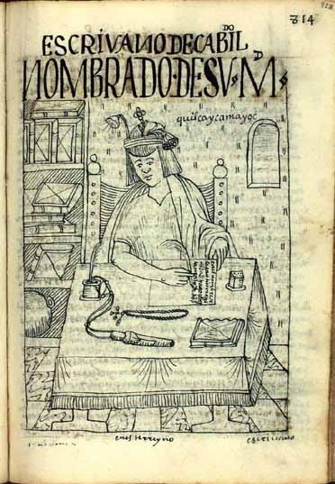{height=10cm}
:::

::: {custom-style="Pie de figura"}
**Imagen 1.** *Escribano de cabildo*. Dibujo de Felipe Guaman Poma de Ayala, *Nueva corónica y buen gobierno*, 1615, p. 814 [828], dibujo 307. Fuente: Det Kgl. Bibliotek, Copenhague, GKS 2232 4º. Dominio público.
:::

La palabra *manuaje* tiene antecedentes, que Cárcamo Pino repasa. Uno de ellos es Randall McLeod, quien llamó *manuage* al idioma de los *choughs* en *All's Well That Ends Well*, de Shakespeare, un idioma «inventado in situ por los personajes» y hecho «con la mano de Shakespeare, no con la boca» (Cárcamo Pino, 2025b: 241-242). The Voidz, la banda de Julian Casablancas, lleva la idea al extremo en el título de una canción, «All Wordz Are Made Up», según el cual todas las palabras son inventadas (The Voidz, 2018). Inventar, en ese sentido, quiere decir hacer, y no mentir. Hechas fueron la ordenanza del doctor Mendoza y la genealogía imperial que se atribuyen los Villca, pero también los títulos coloniales que las comunidades desenterraron para litigar (Rivera Cusicanqui, 2010 [1984]: 99). Lo que distingue unas palabras de otras es quién consigue que las suyas valgan como ley.

No todo dibujo descubre algo. Javier Seguí de la Riva distingue el dibujo que puede «servir como ilustración de un texto narrativo previo» de aquel en que la mano encuentra lo que no se sabía (Seguí de la Riva, 2010: 93), y Tim Ingold separa los dibujos que cuentan de los que «especifican» (Ingold, 2013: 125), como los planos de arquitectos e ingenieros. Los esquemas de encaje que reproducimos ilustran y especifican; descubrir, no descubren nada, aunque obligan a decidir. Se parecen a los dibujos que, según cuentan Monteys y Fuertes, hizo Gordon Cullen para los edificios de Berthold Lubetkin, que no servían para medir y en cambio «mostraban cómo construir, montar o incluso reparar», e incluían «personas haciendo cosas» (Monteys y Fuertes, 2001: 128, 132). Por eso cada esquema anota, junto al trazo, lo que hace la mano, de acuerdo con la definición más sencilla que da Seguí: «Dibujar es dejar huellas estables en un soporte a partir de movimientos corporales» (Seguí de la Riva, 2010: 13).

El método sigue los cuatro pasos que Simon Lundberg propone para explorar la imagen arquitectónica: observación, disección, ensamblaje e inmersión (Lundberg, 2019: 3). En la *observación* reunimos en un fichero los datos del texto, cada uno con su página. La *disección* separa las partes y las ordena según cuatro funciones constructivas, que son el apoyo, el vano, la masa y el límite (Cuadro 1). En el *ensamblaje* esas partes vuelven a juntarse, como en el *capriccio* de Canaletto, que reunía edificios de ciudades distintas en una ciudad «completamente imaginaria» (ibid.: 3), y las decisiones que se toman en ese paso, sea un perfil o una analogía, son del dibujante y no cuentan como hallazgos. La *inmersión*, por último, da atmósfera sin confundirse «con el realismo visual» (ibid.: 21).

El ensamblaje tiene además una teoría propia, la de la collage. Fuão la describe en cuatro tiempos (el recorte, los fragmentos o figuras, los encuentros y la cola) y sitúa lo decisivo en el «intervalo» entre cortar y pegar, cuando las figuras recortadas se prueban unas junto a otras «antes de que la cola las fije» (Fuão, 2011: 8, 52). En ese intervalo se toman las decisiones del dibujo. Fuão pone una condición que adoptamos: se pueden juntar figuras e ideas lejanas, siempre «con la condición de que haya una referencia explícita» que permita la analogía (ibid.: 53).[^comillas] La cumplen también las cinco imágenes de dominio público que el artículo reproduce en serie aparte de las figuras (imágenes 1-5), porque cada una va junto al pasaje que la pide y, sin ilustrar la novela, muestra lo que esta calla o aquello con lo que contrasta. Monteys y Fuertes llaman *casa collage* a una casa hecha así, de ideas reunidas, que «no cabe en una sola casa» (Monteys y Fuertes, 2001: 12).

[^comillas]: Este artículo está hecho, literalmente, de recortes, entre ellos más de ciento cincuenta citas de la novela. Fuão ve en las comillas «la mejor evidencia del recorte», una herida que marca «una sutura de cuatro puntos» (Fuão, 2011: 39).

El pastel conviene a esta novela porque su prosa mide el espacio con el cuerpo. En la jaula de la mina, Condori siente, «como si faltase suelo bajo sus pies», «la vertiginosa caída» (Botelho Gosálvez, 1982 [1945]: 143). Abbie Garrington llama *háptico* a ese registro del tacto y del movimiento del cuerpo (Garrington, 2013: 16), y a una prosa así parece corresponderle un dibujo hecho con los dedos. Cada figura se examina en tres planos. En el primero, (1) *Texto*, está lo que describe la novela; en el segundo, (2) *Operación*, lo que hace el pastel con la materia; en el tercero, (3) *Contraste*, lo que el esquema obliga a decidir y el texto deja abierto o contradice, comparado cuando se puede con fuentes andinas.

**Cuadro 1.** *Disección tectónica de las seis figuras*

| Figura | Apoyo | Vano | Masa | Límite |
|---|---|---|---|---|
| 1. Cráneo/nido | Muros de piedra del cerro (8); vigas atadas con paja (31) | La puerta; el portal de la despedida (34) | Hollín, brasero, camastros de un adobe (30-31) | Techo de paja con cruz y huaca (10) |
| 2. Signo Escalonado | Peones que sostienen a los Villca (21) | Quienes «no tienen historia» (22) | Tierras de los Villca (20) | Estacas, mojones, títulos (9, 20, 36-37) |
| 3. Apacheta | Paulo, «gallardete clavado» (109) | «Fauces del abismo» (109) | Cumbres «góticas», niebla (109) | «Muralla que condena el horizonte» (108) |
| 4. Castillete | Callapos; viga que se quiebra (145, 154) | Pique, nichos, jaula, boquete (141-144) | Agua, cascotes, montón (144, 154) | Rejilla; agua sobre el cuerpo (143-153) |
| 5. Pelvis telúrica | Cadera del ganado (64) | Vertientes secas (58) | Tierra agrietada (56) | Cielo sin pincelada (57) |
| 6. Centinela | Cayado; vara de Jilakata (73, 75) | Puertas batidas (79) | Chujlla de los Villca (79) | Mirada sobre la inmensidad (80) |

Fuente: elaboración propia a partir de Botelho Gosálvez (1982 [1945]); entre paréntesis, páginas de la novela.

## 3. La chujlla: una casa a la medida del cuerpo

El narrador presenta el ayllu desde lo alto, como en un plano de situación: «las chujllas de las familias más antiguas han trepado en los riscos del cerro y desde allí parecen ocupar un sitio de preeminencia sobre el resto de chozas» (Botelho Gosálvez, 1982 [1945]: 6). Todo depende del verbo *parecen*, porque la jerarquía es una lectura que el narrador hace sobre la pendiente y que la pendiente, por sí sola, no dice.

La chujlla de los Huanca tiene dos metros de alto, paredes «renegridas por el hollín» y camastros de «apenas la altura de un adobe», y de sus vigas, «mal unidas con lazos de paja trenzada», cuelgan «las hoces, el arado, el yugo de madera» (ibid.: 30-31). En ella se juntan las dos maneras de construir que distingue Frampton, los muros de piedra y adobe que pesan y un armazón atado como una cestería (Frampton, 1995: 5). Es una casa que se mide con el cuerpo y que funciona como caja de herramientas, algo que para Cárcamo Pino es a las manos lo que un idioma es a la lengua (Cárcamo Pino, 2025a: 12). Monteys y Fuertes le piden eso mismo a la cocina moderna, que no esconda sus utensilios y los cuelgue a la vista hasta que «ella misma deviene utensilio» (Monteys y Fuertes, 2001: 112). Para ellos, «una casa es una vivienda más la gente que la habita y los objetos que guarda» (ibid.: 14), y Christopher Alexander piensa que un cuarto vale cuando deja ver «las cosas que cuentan tu historia» (Alexander et al., 1977: 1166). De las vigas de los Huanca cuelgan también «los ponchos y rebozos para los días de fiesta», y los charangos esperan «la mano que les acaricie» (Botelho Gosálvez, 1982 [1945]: 31). La casa tiene incluso su umbral, el portal desde el que Paulo verá partir a los hijos que la escasez expulsa, «desde el portal de su chujlla» (ibid.: 34). El narrador entra en ella como un intruso que no la habita y que se limita a escribirla, y en los camastros ve una «morada de piojos y pulgas» (ibid.: 31). Pallasmaa recuerda que «la casa es una metáfora del cuerpo y el cuerpo una metáfora de la casa» (Pallasmaa, 2014 [2011]: 159); el cuerpo que el narrador le encuentra a la chujlla es el de una madriguera. Gamaliel Churata, en cambio, puso en *El pez de oro* (1957) la escritura del lado de adentro. En uno de sus retablos, un indio convierte «una de las paredes de su chuklla en abecedario mural», y el obispo y el cura lo llevan preso (Churata, 2007 [1957]: 20), mientras que en las paredes de los Huanca la novela no pone ninguna letra.

**Figura 1. *Cráneo/nido*.** (1) *Texto*. Muros de piedra, el fuego al centro y las herramientas colgadas (Botelho Gosálvez, 1982 [1945]: 8, 30-31) y, en el techo, un crucifijo con «una pequeña huaca de barro cocido» (ibid.: 10). (2) *Operación*. Es un corte a la altura de una persona en cuclillas junto al brasero, y conviene recordar que, para Seguí, la sección «empieza siendo un corte, sajadura de cualquier cosa, rotura, indagación, búsqueda de un interior» (Seguí de la Riva, 2010: 97). La hoja se cubre de negro y siena, el color del hollín, y la luz se saca quitando materia, porque el esgrafiado abre en la masa oscura las vigas, las hoces y el yugo del mismo modo en que el comunario abre la tierra quitándole piedras. El perfil de cráneo, con la bóveda de paja como calota, la puerta como órbita y el fuego donde iría el pensamiento, es una decisión de ensamblaje y no un hallazgo; sirve para llevar al dibujo la correspondencia entre la casa y el cuerpo. (3) *Contraste*. El esquema tiene que decidir desde dónde se mira, y el texto ofrece dos lugares, el del narrador, que se queda de intruso en la puerta, y el del cuerpo que habita, al que remiten el hollín, los camastros y las herramientas. Seguí los distingue así: «Desde dentro es el único posicionamiento para la acción. Desde fuera es la situación narrativa imprescindible para la reflexión» (ibid.: 23). El corte elige el de dentro y se detiene ante el alma de los comunarios, para no hablar por ellos. Es, por lo demás, una manera antigua de mostrar una casa con su vida adentro. Las casas de muñecas «eliminan una pared» para enseñar los objetos que guardan y la relación entre sus ámbitos (Monteys y Fuertes, 2001: 30), y la pintura medieval suprimía las fachadas para poder narrar (Fuão, 2011: 43). Mirar en cuclillas es mirar la casa «en reposo», «desde el punto de vista de quien va a usarla» (Monteys y Fuertes, 2001: 58), y no desde el recorrido de quien entra de visita. El narrador, por su parte, la declara cerrada («nadie podía entrar») y ve a los comunarios como estatuas de «hierático aspecto» (Botelho Gosálvez, 1982 [1945]: 65).

::: {custom-style="Figura"}
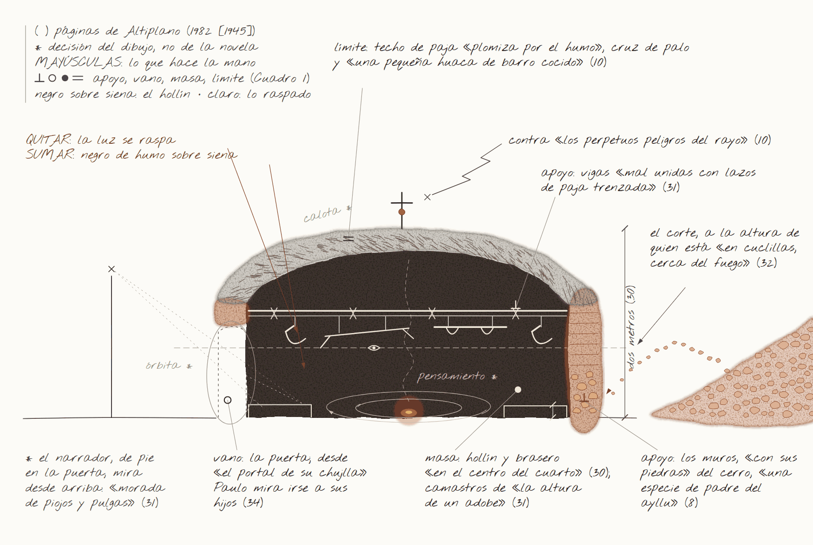{width=14cm}
:::

::: {custom-style="Pie de figura"}
**Figura 1.** *Cráneo/nido: sección de la chujlla de los Huanca*. Esquema de encaje del pastel al óleo. Fuente: elaboración propia con asistencia de IA.
:::

El narrador tampoco le ve cuartos a la casa: «Las chujllas no tienen cuartos ni mucho menos» (ibid.: 30). Sin embargo, los Huanca viven en «tres chujllas de adobe y paja brava que rodean al patio» (ibid.), así que los cuartos son, en realidad, las chujllas. De noche los hijos mayores están en las chozas próximas y entran en la del padre cuando él los llama (ibid.: 31). Alexander y su equipo, que estudiaron con detalle casas populares peruanas, llaman *gradiente de intimidad* a ese orden que va de lo público a lo íntimo y en el que cada persona «sabe exactamente hasta dónde puede penetrar en la casa» (Alexander et al., 1977: 610-611). Monteys y Fuertes describen sin conocerla la casa de los Huanca cuando hablan de una casa que es «el resultado de una operación de agregación, más que de una subdivisión del espacio hasta convertirlo en distintas piezas especializadas» (Monteys y Fuertes, 2001: 56). Churata, que sí conocía esas casas, había descrito una en 1939, en el ayllu de Konkachi, cerca de Chucuito, frente al Titikaka. La mayor «no tiene dos metros», escribe, y la forman «dos habitaciones que hacen ángulo» y que, junto con una pirca, cierran el patio, mientras que la cocina, «esa habitación principal de la vivienda indígena», que sirve tanto para preparar la comida como para «charlar con los amigos», suele quedar fuera, junto a las parcelas (Churata, 2017: 123). Para Alexander, por último, todos los patrones de una casa caben superpuestos «en una simple cabaña de una sola habitación» (Alexander et al., 1977: xliii). Donde el narrador ve una madriguera, cualquiera de ellos vería una casa comprimida.

En el centro de esa casa está el fuego. Los braseros arden «en el centro del cuarto» (Botelho Gosálvez, 1982 [1945]: 30), y Paulo Huanca reúne a sus hijos en cuclillas, «cerca del fuego», para decidir quién se va (ibid.: 32). Para Alexander, lo más básico de un lugar común es «la comida y el fuego» (Alexander et al., 1977: 621). Monteys y Fuertes recuerdan que *hogar* nombra «un modo de domesticar el fuego» y que la casa de origen medieval, «que pervive aun hoy en la tradición rural», no tenía piezas especializadas, porque en ella «se cocina, se trabaja, se recibe o se duerme, y son los muebles, en lugar de las estancias, los que determinan esos usos» (Monteys y Fuertes, 2001: 104). En la chujlla, esos usos se los reparten el brasero, los camastros arrimados a la pared y las vigas de las que cuelgan las herramientas. Hay que admitir, con todo, que también estas son miradas de fuera, aunque admiren lo que el narrador desprecia. Alexander llama a su gradiente un principio «casi arquetípico» (Alexander et al., 1977: 611), y el arquetipo, igual que la naturaleza que critica Cornejo Polar, saca a la chujlla de la historia.

La jerarquía no viene solo de fuera. El antepasado de los Villca llega después de la sublevación de Tupaj Katari, y su hijo Pedro «empotró en el suelo del ayllu las estacas de propiedad y empezó a dominar» (Botelho Gosálvez, 1982 [1945]: 20). La primera estaca la clava, pues, una mano aymara, y con ella entra en el ayllu la idea señorial del suelo. Los Villca inventan genealogías imperiales porque «necesitaban aquel blasón para sustentar su orgullo y su riqueza» (ibid.: 28), de modo que el mito hace las veces de título de propiedad. En Jatun-Kolla hasta la memoria tiene pisos. La de los Villca es «edificante y fantástica», mientras que los peones «no tienen historia», salvo tres palabras: «¡hambre, persecución y muerte!» (ibid.: 22-23). Una canción de The Voidz lleva un título que describe bien ese edificio, «Pyramid of Bones», pirámide de huesos (The Voidz, 2018), con el blasón arriba y debajo los que lo sostienen. El capítulo se cierra con una fórmula: «Así los Villca, Huanca y Condori, son las generaciones del Signo Escalonado» (Botelho Gosálvez, 1982 [1945]: 38). El glosario define el término como «Signo sagrado de Tiwanaco» (ibid.: 163), y el narrador lo convierte en un diagrama de clases, que es justamente lo que advertía Hall.

Esa mirada tiene un antecedente en el propio Tiwanaku. En 1877, el viajero estadounidense Ephraim George Squier publicó un grabado de la gran portada monolítica hecho a partir de sus fotografías; al pie de la piedra se ve a un hombre sentado que trabaja un bloque entre las piernas, y enfrente esperan los viajeros con una mula y un rifle (Squier, 1877: 288; Imagen 2). En su relato, Squier cuenta que un anciano pasaba allí los días labrando una piedra entre las rodillas. Al arriero que le preguntó en aymara qué hacía le contestó que estaba «tallando una cruz», y los viajeros acabaron por verlo «como parte integrante de los monumentos» (ibid.: 302-303). El viajero convierte en piedra al que trabaja la piedra, como hará después el narrador con los comunarios.

::: {custom-style="Figura"}
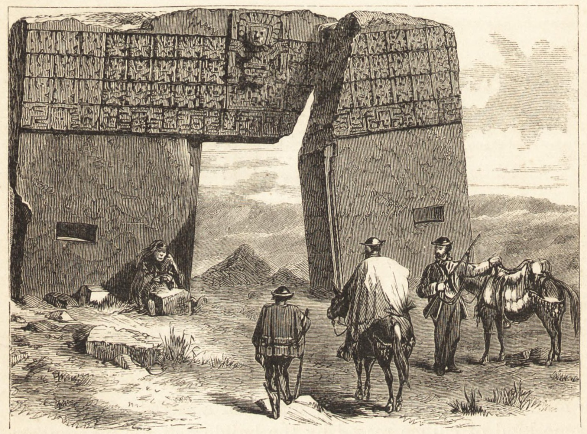{width=14cm}
:::

::: {custom-style="Pie de figura"}
**Imagen 2.** *Frente de la gran portada monolítica* (Tiwanaku). Grabado a partir de fotografías de E. G. Squier. Fuente: Squier (1877: 288), ejemplar del Getty Research Institute en Internet Archive. Dominio público.
:::

El mismo capítulo de la novela cuenta cómo se perdió Kero-Pata, el ayllu de donde venía Juan Condori. Sus comunarios habían estado «amparados por las Cédulas Reales» hasta que, con la República, «los doctores alto-peruanos les birlaron la tierra» (Botelho Gosálvez, 1982 [1945]: 36). El papel protegió y el papel despojó, y lo hizo a través de una cadena de personas. Una hectárea pagada al cura por unos responsos pasa a un doctor, y tras «una gran cuestión de títulos, papel sellado y pago de impuestos» el doctor ya tiene veinte hectáreas, porque «así lo declaraban los papeles del Gobierno». Frente a la iglesia levanta su hacienda: «La religión y la propiedad quedaron frente a frente, guiñándose con sus ventanucos empolvados» (ibid.: 36-37). El título funciona aquí como un mojón que cabe en un bolsillo, que se puede llevar lejos de la tierra y que cambia de mano sin tocarla. Lo que la novela calla es un tercer uso del papel. Después de la Ley de Exvinculación de 1874, las comunidades empezaron «a desenterrar antiguos títulos de propiedad» coloniales, que fueron «una pieza clave en la lucha legal» (Rivera Cusicanqui, 2010 [1984]: 99). Dos años después de publicada la novela, la piedra tuvo también un uso político, cuando en el ciclo rebelde de 1947, en el Altiplano, el asedio a las haciendas incluyó la «destrucción simbólica de mojones o linderos», fogatas y pututus (ibid.: 125).

**Figura 2. *Signo Escalonado frente al mapa*.** (1) *Texto*. En alzado, el orden de las chujllas y de las familias (Botelho Gosálvez, 1982 [1945]: 6, 20-23, 38), que un dato contradice, porque al peón Juan Condori le dan «una chujlla que estaba abandonada cerro arriba» (ibid.: 35). En planta, el «tablero de ajedrez un poco desigual, un poco contrahecho» de los barbechos (ibid.: 9), con sus mojones, estacas y títulos. (2) *Operación*. La hoja junta dos vistas, el cerro en corte, escalonado con capas de empaste, y el catastro en planta, rayado con un punzón sobre la cera. La mancha del dedo corresponde a lo que Cárcamo Pino llama manuaje «en sentido fuerte», el que menos se parece a la escritura (Cárcamo Pino, 2025b: 259). La incisión, en cambio, se parece a escribir o, mejor dicho, a inscribir. Fuão recuerda que las primeras escrituras fueron incisiones en piedras, en barro y en la piel, y que quien hace collage «no escribe, inscribe», o sea, escribe «en profundidad» (Fuão, 2011: 36). Entre el signo y el mapa cambia la operación de la mano, pero la mano es la misma. (3) *Contraste*. El dato estaba en el texto, y el esquema, sin descubrirlo, lo vuelve difícil de ignorar. Dibujado en la misma hoja, el signo no encaja en la pendiente, puesto que el peón vive en un escalón alto y los Villca terminarán en el pesebre de la aldea. La escalera vuelve a armarse en el cocal y en la mina (Botelho Gosálvez, 1982 [1945]: 112, 135), y en eso el mito y el mapa coinciden, porque los dos escalonan.

::: {custom-style="Figura"}
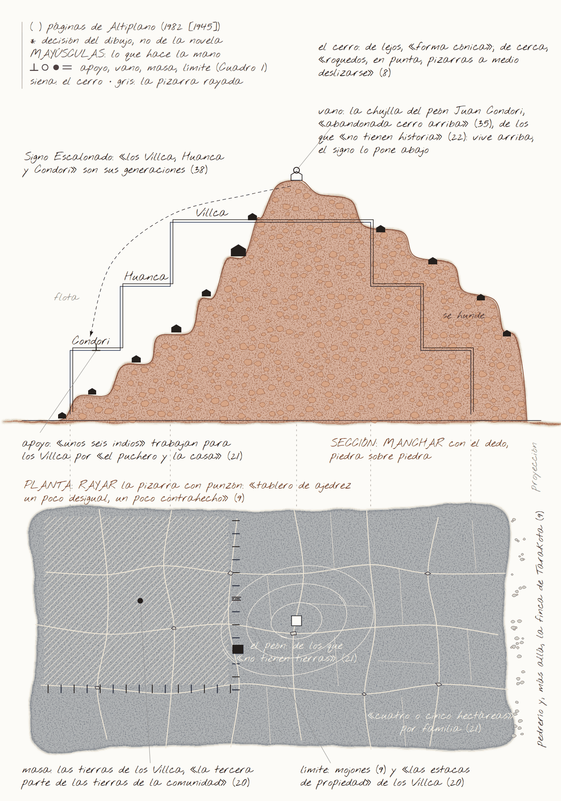{height=16cm}
:::

::: {custom-style="Pie de figura"}
**Figura 2.** *Signo Escalonado frente al mapa: el cerro de Jatun-Kolla en sección y en planta*. Esquema de encaje del pastel al óleo. Fuente: elaboración propia con asistencia de IA.
:::

## 4. Umacachi: la trampa de los papeles

Umacachi, la aldea, está hecha de ocupaciones sucesivas, que son un tambo incaico, una iglesia y un fuerte coloniales y, ya con la República, la decisión de «situar la Sub-prefectura, el Municipio y la Policía donde antes aposentaba la reducida guarnición hispana» (Botelho Gosálvez, 1982 [1945]: 83), de manera que cada poder se ha ido instalando en la cáscara del anterior.

Allí manda el Alcalde vitalicio, el doctor Margarito Mendoza, alias «el lobo», que anda «con el fajo de expedientes bajo el brazo» y sabe «tejer obscuras mallas de términos seudo jurídicos», en una aldea donde los tinterillos «urden pleitos por nada» (ibid.: 86). *Urdir* quiere decir a la vez preparar los hilos del telar y tramar un engaño, y la novela usa las mismas palabras para las tejedoras Huanca, que pasan la lanzadera «a través de la delicada malla», y para los varones, que hacen «bonita urdimbre de surcos» (ibid.: 29). Escribir, tejer y arar comparten así el vocabulario de la mano. En los Andes, además, el hilo servía para registrar. Guaman Poma dibujó a la tejedora y al contador mayor, que llevaba las cuentas del reino en cordeles anudados, los *khipus* (Guaman Poma de Ayala, 1615: 215 [217], 360 [362]; Imagen 3).

::: {custom-style="Figura"}
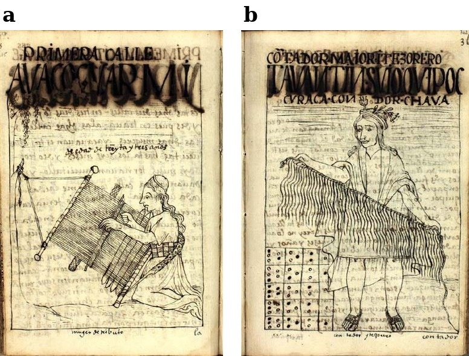{width=13cm}
:::

::: {custom-style="Pie de figura"}
**Imagen 3.** a) *Tejedora de treinta y tres años* (p. 215 [217], dibujo 80). b) *Contador mayor y tesorero*, con su *khipu* (p. 360 [362], dibujo 143). Dibujos de Felipe Guaman Poma de Ayala, *Nueva corónica y buen gobierno*, 1615. Fuente: Det Kgl. Bibliotek, Copenhague, GKS 2232 4º. Dominio público.
:::

El despojo, por otro lado, no tiene un solo villano. Corregidor, alcalde, intendente y cura son «cuatro patas de la bestia opresora del puneño» (Botelho Gosálvez, 1982 [1945]: 13), y son «cinco gendarmes indios» los que arrastran a Vicente Villca al patio donde lo azotan (ibid.: 101). Alexander explica el papeleo por el tamaño, ya que cuando la gente no puede tratarse cara a cara los reglamentos se cumplen «a ciegas» (Alexander et al., 1977: 405). Umacachi lo desmiente, porque es una aldea, Vicente trata en persona con el tinterillo y aun así el papel lo despoja, de modo que lo que mueve el despojo tiene más que ver con la casta que con el tamaño.

Los Villca llegan a la aldea con treinta y cuatro ovejas, y la chola Encarnación les cede el corral por cincuenta bolivianos: «Tu familia puede acomodarse en el pesebre» (Botelho Gosálvez, 1982 [1945]: 92). Entonces llega la letra: «Todos los animales de carneo que existen dentro del radio urbano serán requisados [...] (Fdo.) Dr. Margarito Mendoza» (ibid.: 96). La firma es la del lobo. El radio urbano funciona como un corral invisible, un círculo trazado en un papel que encierra a todos los animales que quedan dentro y que se cierra con una firma. Es un corte en el sentido de Fuão, para quien la tijera, «un instrumento al servicio de la razón», define, y definir es distinguir «entre lo incluido y lo excluido, el dentro y el fuera» (Fuão, 2011: 33-35). La aldea mide con compás, cuando el ayllu medía con la pendiente y con las piedras. James C. Scott observa que un mapa catastral «no se limita a describir un sistema de tenencia de la tierra; lo crea», porque da a sus categorías «la fuerza de la ley» (Scott, 2020 [1998]: 3). El radio hace lo mismo con el ganado, aunque no trata a todos por igual, ya que a los mestizos «no les alcanzaba la Ordenanza» (Botelho Gosálvez, 1982 [1945]: 102). Dos versos de «Pyramid of Bones» lo dicen a su manera, «they play the game by different rules, insisting / it's all equal», juegan con otras reglas e insisten en que todo es igual (The Voidz, 2018). En una sociedad «de dudosa cuantificación como Bolivia» (Zavaleta Mercado, 1986: 21, n. 1), el poder cuenta a ojo. Los animales de los indios, tasados «a ojo de buen cubero», entran por el «embudo» de las fincas del Alcalde «hasta esfumarse» (Botelho Gosálvez, 1982 [1945]: 102), y por el otro extremo sale papel, porque la fortuna de los Villca se reduce «a mil seiscientos bolivianos en papel» (ibid.: 103).

La letra, además, pesa. En el cuartucho del tinterillo al que acude Vicente hay «un desordenado montón de papeles y libracos» (ibid.), otra vez un montón. El letrado cobra la defensa por peso; señala «un Código Penal en infolio y un manual del Procedimiento Civil» y asegura que el grande «tiene más peso legal y jurídico que el chiquitito» (ibid.: 104). El tinterillo, de hecho, apenas escribe; señala, compara y al final «recontó los billetes», mientras Vicente, para pagar, tiene que «desanudar la punta de la faja» donde guarda «un atado de pobres y traposos billetes» (ibid.: 105). Como en la escena de Cajamarca con que se abre el libro de Cornejo Polar, el libro es aquí «mucho más fetiche que texto y mucho más gesto de dominio que acto de lenguaje» (Cornejo Polar, 2003 [1994]: 41). Vicente no puede leer el código, pero sabe leer a quien se lo vende: «estos tinterillos son de una sola casta y todos obran con una mala fe del demonio» (Botelho Gosálvez, 1982 [1945]: 104). La escena, por lo tanto, no enfrenta a un indio ignorante con la escritura. Lo que calla es que, en la historia, los «abogados de pueblo (peyorativamente designados como “tinterillos”)» asesoraron la lucha legal de las comunidades y fueron «la manifestación embrionaria del indigenismo criollo» (Rivera Cusicanqui, 2010 [1984]: 101), el mismo indigenismo al que pertenece la novela. Para el Estado esos escritos eran sospechosos, y una circular de 1886 atribuía las «doctrinas» de los reclamos indígenas a «los encargados de consignar por escrito sus reclamaciones» y mandaba procesar a los indios y a los autores de los escritos (Barnadas, 1978 [1975]: 46-47).

Dos niños mueren de hambre y los entierran «allí mismo, bajo el suelo del pesebre, para evitar el pago al cura y el municipio» (Botelho Gosálvez, 1982 [1945]: 106). El pesebre, «donde el viento entraba por todas partes» (ibid.: 105), pasa de refugio a jaula y de jaula a tumba. Los Villca «habían sido domesticados por la aldea» (ibid.: 107), y como *domesticar* viene de *domus*, casa, podría decirse que la aldea los alojó como se aloja a los animales de casa.

## 5. El éxodo: los Yungas y la mina

El éxodo a los Yungas empieza en un umbral: «Tras de la muralla que condena el horizonte del altiplano empieza el yunga» (Botelho Gosálvez, 1982 [1945]: 108). El valle, que en el archipiélago de Zavaleta sería otro piso de la misma tierra, es para los jóvenes del ayllu una «fábula» (ibid.: 7), y del otro lado los espera la finca. Monteys y Fuertes retoman para la ciudad la *casa difusa* de Gerardo Ragone, «una casa compuesta de piezas dispersas en el territorio» (Monteys y Fuertes, 2001: 146); a su manera, el archipiélago andino era una casa así, y el éxodo, en lugar de extenderla, la deshace. En la apacheta, el viento sacude el poncho de Paulo Huanca «como un gallardete clavado en la ceja de la apacheta», su familia reza de rodillas y las cumbres se alzan «semejantes a fantásticas construcciones góticas» (Botelho Gosálvez, 1982 [1945]: 109), como si el narrador mirara la cordillera con la arquitectura de Europa.

Del otro lado, las manos del puneño pierden su oficio: «Sabrás arar en la puna, pero aquí esa es otra música» (ibid.: 113). Paulo se va consumiendo, «derritiéndose como muñeco de cera» (ibid.: 123). En el aserradero, el contratista le echa en cara que otro puneño «se ha cercenado una mano en la sierra» (ibid.: 129), y la mutilación termina usándose como argumento contra las víctimas. La hija mayor de Paulo, a quien el narrador presenta dejando «ver sus nacientes senos» (ibid.: 125), «había sido desflorada por el patrón»; «en seguida vinieron los capataces y peones: le daban dinero», y la desesperación la «obligó a venderse» hasta que «con su propia mano se quitó la vida» (ibid.: 132). Ella no tiene nombre, y su historia cabe en un inciso, «vieja historia». Una violencia que empezó el patrón se cuenta así como una venta de la muchacha. Su padre jura que fue un crimen, pero «las pruebas eran irrefutables» (ibid.). La palabra *crimen*, que el narrador reserva para la muerte de Condori (ibid.: 154), no llega a alcanzar al patrón, y lo único que la novela deja hacer a la mano de la muchacha es quitarse la vida. El único cruce que sale bien lo hacen los monos, que forman sobre el río «una cadena cogiéndose de manos» (ibid.: 121).

**Figura 3. *Umbral de la apacheta*.** (1) *Texto*. El glosario define la apacheta como «abra de las cordilleras y cumbre de los caminos» (Botelho Gosálvez, 1982 [1945]: 160), es decir, como un lugar y no como un montón. Es también un paso peligroso, y así lo dice Paulo Huanca cuando bendice a sus hijos: «Que Dios les alumbre el camino y que en las apachetas no les detenga el Supaya» (ibid.: 33). La novela la marca con un cuerpo erguido, la familia arrodillada y la «fauce» del yunga (ibid.: 109) y, más abajo, con el puente de monos (ibid.: 121). (2) *Operación*. Una hoja apaisada partida por la cresta. Del lado de la puna hay pastel seco sobre papel de grano grueso, que asoma como si fuera piedra; del lado del yunga, pastel disuelto en capas transparentes que chorrean, y en la cresta una técnica se convierte en la otra. (3) *Contraste*. El esquema sigue al texto y dibuja un umbral sin montón. El aymara colonial, sin embargo, llama *apachita* al «montón de piedras, que por superstición van haciendo los caminantes y los adoran» (Bertonio, 2011 [1612]: 317), en el que se pegaba «coca mascada con las manos» (ibid.: 349), un montón que crece con cada viajero. La novela lo cambia por una muralla y un cuerpo clavado. Bertonio registra, por otra parte, que *thaxsi* era a la vez «el cimiento» y «el horizonte o término de la tierra» (ibid.: 486), así que el horizonte que el narrador ve condenado por una muralla era en aymara una base sobre la cual asentarse. Ingold, para quien hacer es corresponder con los materiales, advierte que convertir esas cosas en monumento o en rasgo del paisaje «es interrumpir de golpe la correspondencia» (Ingold, 2013: 86). En la hoja partida, los Yungas son un cambio de estado de la materia y de la mano, y la cera se funde como Paulo, una *wank'a* fuera de su lugar. Lo único que cruza el abismo es colectivo y está hecho de manos, como la apacheta que falta. Para Fuão, la cola es ese puente sobre «el abismo del recorte», lo que comunica a los pueblos «separados por las gargantas de los abismos geográficos» (Fuão, 2011: 80).

::: {custom-style="Figura"}
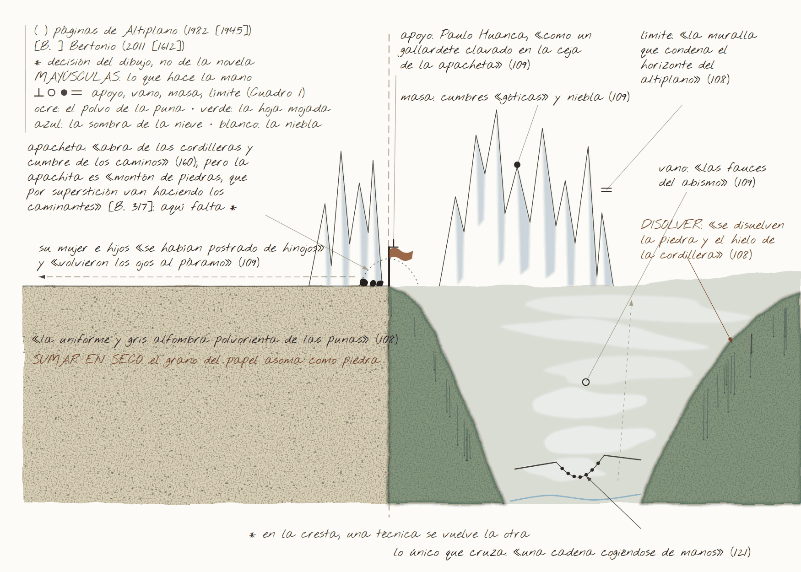{width=14cm}
:::

::: {custom-style="Pie de figura"}
**Figura 3.** *Umbral de la apacheta: la ceja de la cordillera y la fauce del yunga*. Esquema de encaje del pastel al óleo. Fuente: elaboración propia con asistencia de IA.
:::

La mina «Pensylvania», de la compañía yanqui The Star Syndicate, se anuncia con «el encaje de acero de la torre de un andarivel» (Botelho Gosálvez, 1982 [1945]: 134-135). El campamento repite la escalera, desde los chalets de los ingenieros hasta el «enjambre de cuchitriles de calamina» de los mineros (ibid.: 135). Una vista de la mina de estaño Siglo XX, de Patiño Mines and Enterprises, tomada entre 1940 y 1946, muestra un orden parecido, con casas mayores de techo a dos aguas abajo, junto a las instalaciones, y más arriba, en la ladera, hileras de viviendas pequeñas e iguales (Imagen 4). La empresa registra a Condori: «Tomaron su identidad e impresiones digitales» (ibid.: 140). Su mano entra en el archivo sin agarrar nada, apoyada como un sello, y esa es su primera firma. Cornejo Polar observa que la escritura sitúa a quienes no la dominan «como puros soportes físicos» (Cornejo Polar, 2003 [1994]: 68), y eso es lo que hace aquí la huella. Fuão, que toma la idea de Peirce, la llama *índice*, una «conexión física entre representante y representado», como el humo lo es del fuego (Fuão, 2011: 28), que sirve a lo que él llama «el control sobre los cuerpos», el «registro institucional» (ibid.: 48). Por la mañana, Condori camina hacia la entrada por el desmonte (Botelho Gosálvez, 1982 [1945]: 140), la montaña de roca sin mineral que la mina saca y amontona, otra montaña de piedras, hecha esta vez con un cerro deshecho. El capataz le promete entonces otra cosecha: «Aquí cosecharás miles de cargas de estaño» (ibid.: 142).

::: {custom-style="Figura"}
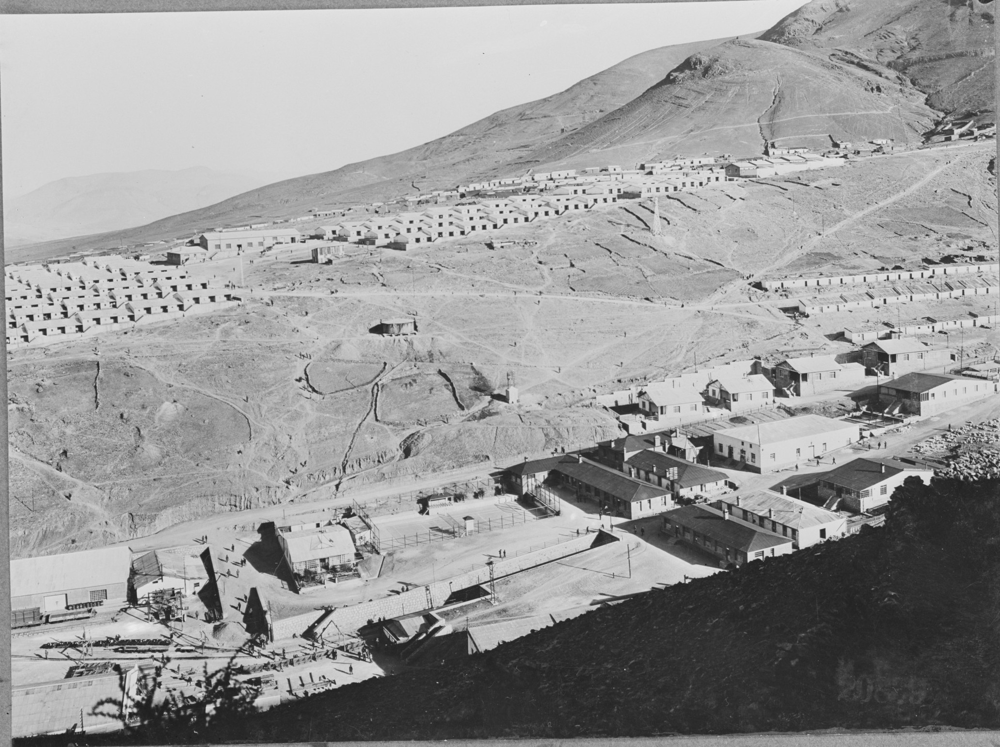{width=14cm}
:::

::: {custom-style="Pie de figura"}
**Imagen 4.** *Vista general de las minas de estaño Siglo XX* (Patiño Mines and Enterprises), entre 1940 y 1946. La tira del negativo dice «Catavi». Fuente: Library of Congress, Prints & Photographs Division, colección FSA/OWI, LC-USE6-D-000117. Dominio público.
:::

Se baja en jaula. En la entrada, los huecos de las jaulas se ven en el muro «como dos enormes nichos», y en una de ellas van siete hombres «apeñuscados contra la rejilla» (ibid.: 141-143). Abajo, Condori hace el mismo trabajo que hacía en el ayllu, acarrear cascotes, esta vez para abrir «un boquete» hacia el plano «450» (ibid.: 144). La galería es como la chujlla puesta al revés, porque en la casa los muros se levantan y en la mina la masa se excava y la sostiene un armazón de madera. En el «450», que «se derrumbaba en algunos pasos», «recién ponían el revestimiento de callapos» (ibid.: 145), los troncos que sostienen la galería. Cuando la mina se inunda, la empresa baja «rieles, maderos, dinamita, hombres» (ibid.: 151), con los hombres al final de la lista de materiales. Es un montaje en el sentido de Fuão, una actividad «más técnica, más mecánica, un juntar y pegar», distinta de la collage, que cambia el sentido de lo que junta (Fuão, 2011: 102); la palabra *fotomontaje*, recuerda, nació «de la cultura industrial, del montaje de turbinas, de máquinas» (ibid.: 97). El agua va midiendo el cuerpo, de los tobillos a las rodillas, a la cintura y al ombligo (Botelho Gosálvez, 1982 [1945]: 145, 152-153), y cuando Condori intenta retroceder, el ingeniero Williams «le abrió un boquete en la cabeza» (ibid.: 153), con la misma palabra que se usa para la roca. Luego «quebróse la viga del techo», cede el armazón y la masa recobra su peso. El derrumbe sepulta a todos, y «nadie sospechó el crimen» (ibid.: 154).

**Figura 4. *El castillete y la caída al plano 450*.** (1) *Texto*. La torre, el campamento escalonado, los nichos, la jaula, la galería inundada y el derrumbe (Botelho Gosálvez, 1982 [1945]: 134-154). (2) *Operación*. Arriba está la torre, rayada en la cera como un encaje, con el desmonte por el que se entra a la mina (ibid.: 140); debajo, el pique y los niveles, como los pisos de un edificio puesto al revés. Los siete cuerpos de la jaula se hacen con el dedo, sin línea, y la rejilla se raya encima. Al fondo, el pastel disuelto sube por los cuerpos como sube el agua. (3) *Contraste*. Puestos uno sobre otro, la escalera de la superficie y los niveles de abajo muestran la mina como un doble invertido del ayllu. El gesto sigue siendo el de despejar y amontonar piedras, aunque ahora lo captura una máquina que lo convierte en mercancía y que convierte el cuerpo en material.

::: {custom-style="Figura"}
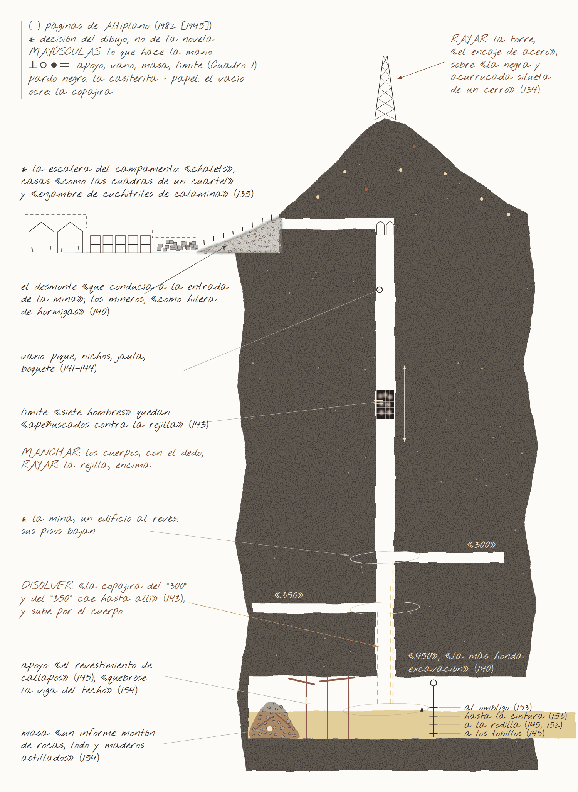{height=16cm}
:::

::: {custom-style="Pie de figura"}
**Figura 4.** *El castillete y la caída al plano 450*. Esquema de encaje del pastel al óleo. Fuente: elaboración propia con asistencia de IA.
:::

## 6. La sequía y el linchamiento: el cuerpo en la catástrofe

La sequía se cuenta con palabras de arquitecto y de dibujante. Las sementeras «se agrietan como paredes envejecidas» (Botelho Gosálvez, 1982 [1945]: 56), y el narrador escribe que «Ni una pincelada enturbió el papel celeste y deslumbrador del cielo» (ibid.: 57). En la rogativa, los comunarios avanzan de rodillas y su piel sangrante deja «manchones en el cascajo» (ibid.: 60), como si los cuerpos dibujaran sobre el suelo. Cuando salen del ayllu, las casas ajenas se les cierran. A los vecinos la sequía «les endureció el alma como había endurecido la tierra», y los reciben «dándoles con las puertas» y a pedradas (ibid.: 80).

El yatiri Basilio Quispe, que vendía «piedra bezoar» (Botelho Gosálvez, 1982 [1945]: 66), es acusado de causar la sequía cuando de sus ropas caen «dos muñequitos de lana» atravesados por una espina (ibid.: 67). Justina Huanca lo araña «como la fiera y brava hembra del puma» y «los indios le descuartizaron» (ibid.: 68). El narrador anota «un ardor bestial» y cierra con una dispersión: «cada cual se llevó un miembro»; Justina atraviesa con espinos los genitales del muerto, «sintiendo en lo íntimo de su conciencia de hembra» la venganza, y «en muchos sitios enterraron los pedazos del cuerpo» (ibid.: 69). Fuão distingue la fragmentación, que despedaza, de la dispersión, en la que los pedazos, «separados del cuerpo original», quedan «distanciados unos de otros» (Fuão, 2011: 16), y el linchamiento hace las dos cosas. La escena admite, creemos, dos lecturas. Una pasa por Francis Bacon, en cuya *Crucifixión* (1965) dos jueces examinan «las manipulaciones de la carne» (Martin, 2014: 85), como la comunidad y el lector ante el cuerpo de Basilio. La otra pasa por la *kenchería*, «mal de ojo, brujería» (Botelho Gosálvez, 1982 [1945]: 162), según la cual la espina del muñeco reaparece en la carne y la efigie actúa. El narrador presenta a la multitud como animales, vuelve sexual la furia de Justina y sienta al lector en la tribuna, como a un juez. Fuão llama *voyeurismo* a esa posición, que consiste en separar al observador del objeto «mediante un distanciamiento de la mirada y el ocultamiento del propio cuerpo» (Fuão, 2011: 24). Por eso la serie no dibuja el linchamiento, ya que un pastel de ese cuerpo sería otra efigie, y reunir sus pedazos en una hoja, otra collage.

**Figura 5. *Pelvis telúrica / Pachamama sorda*.** (1) *Texto*. «La Pacha Mama, sorda, vieja, extenuada, recibía el cuerpo de sus más fieles hijos para encerrarlos en su vientre de sequedad inexorable» (Botelho Gosálvez, 1982 [1945]: 66); las vacas hambrientas muestran «las nalgas abiertas a la manera de una luna menguante» (ibid.: 64). (2) *Operación*. El cielo se deja en papel desnudo, como si la sequía fuera una falta de pincelada. La cuenca seca de las vertientes (ibid.: 58) se dibuja como una pelvis, la cadera del ganado vuelta luna menguante, en blanco hueso sobre tierra de sombra y agrietada a punta de raspado. (3) *Contraste*. Que la tierra sea madre no lo inventa el narrador. Para Bertonio, *Pachamama* era «nombre de reverencia», y se le decía «yo seré tu hijo» (Bertonio, 2011 [1612]: 420). Lo que pertenece al narrador es el tono, el de una tierra que «abortó en plena gestación» (Botelho Gosálvez, 1982 [1945]: 66) y que al final es «hembra paridora» (ibid.: 159); hasta el ayllu vacío es para él un «solar histérico, infecundo» (ibid.: 79), con una palabra que viene de *hystéra*, útero. Dibujada como pelvis, es decir, como un hueso que carga peso y no como un recipiente, la metáfora pasa del sexo a la construcción y deja ver lo que cuesta, porque la alegoría se traga a las mujeres reales, desde Melchora Mamani (ibid.: 35) hasta la hija sin nombre de Paulo Huanca.

::: {custom-style="Figura"}
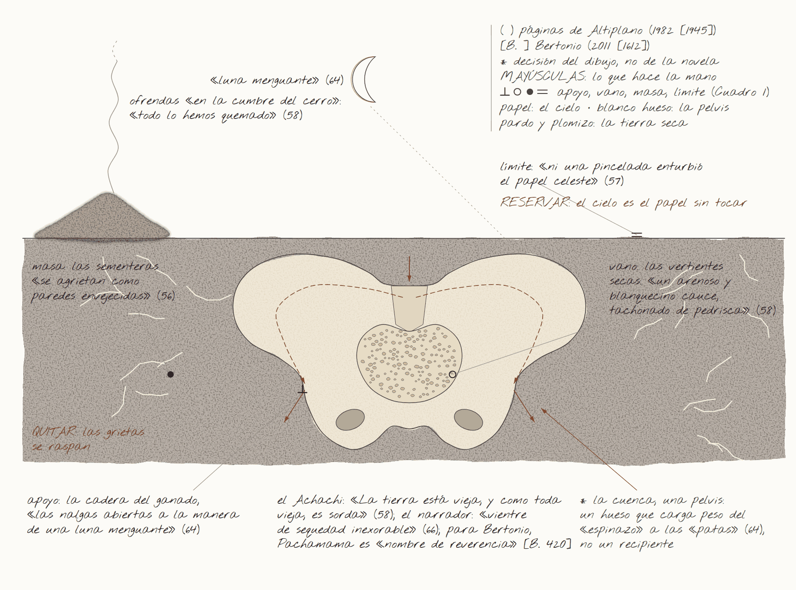{width=14cm}
:::

::: {custom-style="Pie de figura"}
**Figura 5.** *Pelvis telúrica / Pachamama sorda*. Esquema de encaje del pastel al óleo. Fuente: elaboración propia con asistencia de IA.
:::

**Figura 6. *El centinela de la resistencia*.** (1) *Texto*. Cuando el Consejo decide partir, el centenario Braulio Choquehuanca, «apoyándose con dificultad en el cayado de palo», pide amor por la tierra y lo hacen callar (Botelho Gosálvez, 1982 [1945]: 75). Quedan «tres vigilantes al cuidado del ayllu» (ibid.), peones sin tierra instalados «en la chujlla de los Villca, la más amplia y cómoda» (ibid.: 79). (2) *Operación*. Un nocturno vertical con tres figuras en el vano de la chujlla vacía, trazadas como postes o mojones, y el cayado como cuarto apoyo. Alrededor, en capas finas extendidas con el dedo, las puertas golpeadas por el viento y los muertos que salían de la tierra «para mirar el cielo» (ibid.: 80). (3) *Contraste*. El narrador llama a los vigías «cancerberos» y «muertos en vida» (ibid.), pero también «celadores y enfermeros» (ibid.: 79). El esquema los traza como mojones, una decisión que el aymara respalda y el texto no. *Achachi*, que el glosario traduce por «anciano» (ibid.: 160), es también «la cepa de una casa o familia» y el «término o mojón de las tierras» (Bertonio, 2011 [1612]: 307). *Saywa*, «el montón de piedras puesto por mojón», servía además para nombrar a una persona «en quien hallan todo amparo»: «Amparo, defensor, refugio, padre» (ibid.: 447). En el aymara de Bertonio, por lo tanto, el mojón es también alguien que cuida. Idos los achachis que decidieron el éxodo, los sin tierra quedan como mojones del ayllu vacío. Su resistencia, puesto que el discurso de Braulio fracasa, tiene poco de gesta y mucho de trabajo de mantenimiento, y la hace el escalón más bajo del Signo en la casa del más alto. Son lo que Fuão llama la figura de la espera, la que «aguarda y guarda» (Fuão, 2011: 65).

::: {custom-style="Figura"}
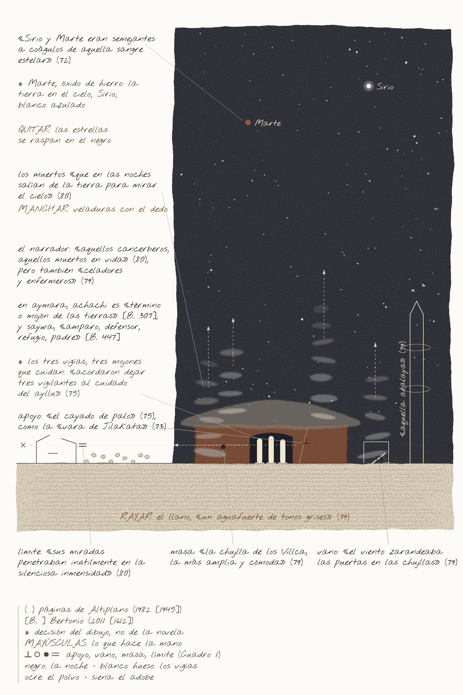{height=16cm}
:::

::: {custom-style="Pie de figura"}
**Figura 6.** *El centinela de la resistencia: los tres vigías del ayllu vacío*. Esquema de encaje del pastel al óleo. Fuente: elaboración propia con asistencia de IA.
:::

## 7. El retorno: reparar la casa, elegir la memoria

Con las heladas vuelven los sobrevivientes, que «en el dintel de Jatun-Kolla se detenían para ponerse de rodillas y besar el suelo que habían abandonado en el terror de la mala época» (Botelho Gosálvez, 1982 [1945]: 155). El ayllu tiene dintel, como una casa. Volver es también juntar lo disperso, porque las familias llegan «de los cuatro rumbos de la pampa» (ibid.), y Fuão escribe que la palabra *cola* conserva en todos sus derivados el sentido de lo que «aglutina, reúne, lo que fue disperso» (Fuão, 2011: 81). Han muerto más de ciento cincuenta comunarios (Botelho Gosálvez, 1982 [1945]: 156). Reparar es, en este punto, un trabajo de manos y de piedra: «Las chujllas fueron reparadas del estrago, las pircas de piedra que separan las parcelas fueron compuestas» (ibid.). La palabra *compuestas*, que los tratados de arquitectura reservaban al arquitecto, vuelve aquí como faena comunal. Durante el éxodo los techos se habían desfondado (ibid.: 79), y en aymara *uta* es la casa y también su «cubierta, techo de la casa» (Bertonio, 2011 [1612]: 132), de modo que rehacer el techo es rehacer la casa. Recomponer la pirca, por su parte, es volver a amojonar, lo que el aymara llama *saywaña*: «mojonar las chácaras con montones de piedra» (ibid.: 466). Alexander define la propiedad por el control y no por el dinero, y pide «el poder legal y la oportunidad física de modificar y reparar sus propios lugares» (Alexander et al., 1977: 395). La novela separa esas dos cosas, y deja el poder en los papeles y la oportunidad en las manos. Reparar a la vez la casa y el lindero es lo que Alexander le pide a todo el que construye: «reparar el mundo a su alrededor, y dentro de él» (ibid.: xiii).

En Umacachi, la ordenanza se llevó los bueyes de los Villca, que se lamentaban: «Y ni siquiera tenemos una yunta» (Botelho Gosálvez, 1982 [1945]: 105). Al volver, sin yuntas, «los mismos hombres eran quienes tiraban el arado» (ibid.: 156). El cuerpo ocupa el lugar del buey, y además recuerda. Bachelard escribe que, al volver a la casa antigua, «los gestos más finos, los gestos primeros, son súbitamente vivos, siempre perfectos», porque «la casa natal ha inscrito en nosotros la jerarquía de las diversas funciones del habitar» (Bachelard, 1983 [1957]: 45, cit. en Monteys y Fuertes, 2001: 42). El narrador, sin embargo, vuelve a convertirlos en piedra y los hace trabajar «con una voluntad de siglos de piedra» (Botelho Gosálvez, 1982 [1945]: 156), una piedra fuera de la historia, muy distinta de la *wank'a* con dueño y con lugar. Abrir la tierra, en cambio, tiene historia en los Andes, y tuvo su herramienta. El arado que cuelga en la chujlla, junto al yugo (ibid.: 31), se hizo para el buey, y el andino, para el cuerpo. En el agosto que dibujó Guaman Poma, una fila de hombres abre la tierra con arados de pie, las mujeres trabajan de rodillas frente a ellos y el dibujo escribe su canto: «ayau haylli yau» (Guaman Poma de Ayala, 1615: 1153 [1163]; Imagen 5).

::: {custom-style="Figura"}
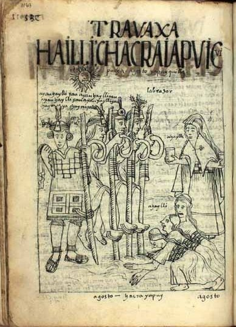{height=10cm}
:::

::: {custom-style="Pie de figura"}
**Imagen 5.** *Agosto: cantos triunfales, tiempo de abrir las tierras*. Dibujo de Felipe Guaman Poma de Ayala, *Nueva corónica y buen gobierno*, 1615, p. 1153 [1163], dibujo 393. Fuente: Det Kgl. Bibliotek, Copenhague, GKS 2232 4º. Dominio público.
:::

La memoria se construye igual que la casa. Cada uno guarda sus padecimientos «con el mismo pudor de los ex carcelados», y la memoria «no recordaba sino lo pasado antiguo, lo bueno y lo alegre de las cosechas» (Botelho Gosálvez, 1982 [1945]: 156):

> Tras la muralla de su visión, como foso hondo y alquitranado, estaba el intervalo del hambre; los comunarios, desde la atalaya de la esperanza, sólo miraban el horizonte, sin atreverse a bajar la cabeza al tremendo hoyo de la escasez pretérita (ibid.: 156-157).

Con una muralla, un foso y una atalaya, la memoria del retorno se levanta como un edificio, y el olvido se construye con ella (Figura 7). Dean lo dice de las piedras incas, «memorias materializadas»: «recordar una versión del pasado exige olvidar o reprimir otra versión de ese mismo pasado» (Dean, 2010: 39). Fuão describe ese olvido como el trabajo de la cola, que crea «la ilusión de integridad» y que «no cura ni salva, solo cierra la boca de los abismos» (Fuão, 2011: 88); el tiempo, añade, es la más potente de las colas, porque «cierra cicatrices» (ibid.: 91). Es lo contrario de lo que pide el lema del epígrafe. Los comunarios de la novela no caminan mirando al pasado, sino que lo esconden en un foso. Dos versos seguidos de «Father Electricity» juntan los dos gestos de esa memoria, «I do not want to see the whole mess / I wish I could live in retrospect», no quiero ver todo el desastre, ojalá pudiera vivir mirando atrás (Julian Casablancas+The Voidz, 2014). Los comunarios miran atrás, aunque lo hacen para saltar el foso y no para caminar, como quiere el lema, y por eso recuerdan las cosechas y no el hambre.

La selección tiene nombres: «Llegaron los Villca, los Huanca, los Huallpa, los Yupanqui, los Ticona, los Choque, los Chuquihuanca» (Botelho Gosálvez, 1982 [1945]: 156). Faltan los Condori, los Mamani y los Quispe, la «legión» sin tierra que cerraba la escalera del narrador (ibid.: 22), de modo que el Signo Escalonado se rehace sin su último escalón. Si, como concluyen Monteys y Fuertes, las personas «son la casa» (Monteys y Fuertes, 2001: 148), el ayllu se rehace incompleto.

Una pirca de doble cara enseña lo que esa memoria olvida. Las piedras grandes dan la cara, pero adentro van las menudas, y sin ese relleno el muro se cae. Bertonio tenía nombre para estas últimas: «Piedra para entremeter en los edificios y llenar sus huecos. Ch'äta, chillpa, k'ak'i qala» (Bertonio, 2011 [1612]: 246). El narrador también llama «legión» a la «piedrecilla menuda» que baja del cerro hasta las pircas (Botelho Gosálvez, 1982 [1945]: 8). Los sin tierra fueron ese relleno; tres de ellos, sin nombre, cuidaron el ayllu vacío, y el retorno no los cuenta. Con la cosecha, los derrotados «olvidaron la pesadilla pasada» (ibid.: 159). Endurecerse para no sufrir la pérdida tiene nombre en aymara, *qalachuyma*, «corazón de piedra», y en un relato de Spedding, para volverse así «hay que lamer el batán de moler» (Spedding, 2025: XV). Bertonio registra incluso un verbo, *qalaptaña*, «volverse piedra o endurecerse» (Bertonio, 2011 [1612]: 444). Contra el susto, la piedra se usa al revés, y se come el bezoar del yatiri, en aymara *jayintilla* (ibid.: 361), o la tierra del lugar del miedo, para «retornar al territorio y a la memoria» (Rodríguez y Rodríguez, 2025: 55). Los comunarios besan el suelo, pero no vuelven a la memoria, y la paz se paga con ese olvido.

::: {custom-style="Figura"}
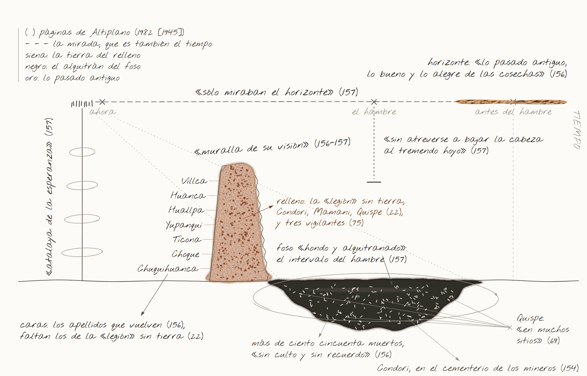{width=14cm}
:::

::: {custom-style="Pie de figura"}
**Figura 7.** *La memoria del retorno*. Diagrama. Fuente: elaboración propia con asistencia de IA.
:::

Ursula K. Le Guin opuso dos formas de contar, la del arma y la del recipiente. «Una novela es un botiquín», escribió, «que contiene cosas en una relación particular, poderosa, entre sí, y con nosotros» (Le Guin, 2021 [1986]: 10). La mina pertenece a la historia del arma, con su jornal, su revólver y su boquete, y el ayllu del retorno, a la del recipiente, porque la casa, «un recipiente para personas» (ibid.: 8), vuelve a guardar la cosecha y a reunir los nombres. Todo recipiente, sin embargo, elige qué guarda, y el narrador cierra con héroes: los derrotados vuelven a ser «los patriarcas fecundadores del suelo, los sembradores del destino» (Botelho Gosálvez, 1982 [1945]: 159). Cornejo Polar describió ese movimiento en la novela indigenista, que imagina el mundo indio como un «estado sólido, siempre repetido» (Cornejo Polar, 2003 [1994]: 181), y el final de *Altiplano* lo confirma, porque no anuncia ninguna rebelión y se limita a restaurar el ciclo. El héroe, advierte Le Guin, no cabe en la bolsa: «Necesita un escenario, o un pedestal, o una cima» (Le Guin, 2021 [1986]: 11), y aquí ese lugar es la atalaya. La novela, que guarda lo que el ayllu prefiere no mirar, resulta ser el recipiente más grande.

## 8. Conclusiones: lo que muestra el dibujo y sus límites

La lectura permite sostener cuatro hallazgos. El primero es que el montón de piedras funciona como la arquitectura mínima de la novela, una masa sin edificio, y que la cosecha de estaño que promete el capataz (Botelho Gosálvez, 1982 [1945]: 142) es la captura de ese gesto por la máquina (Figura 8). El segundo, que el Signo Escalonado vuelve a escalonar a la gente en el ayllu, la aldea, el cocal y el campamento, y que el retorno lo rehace sin su último escalón. El tercero tiene que ver con el despojo, que funciona mediante una cadena de personas, instituciones y soportes (el expediente, el papel sellado, el radio urbano, el infolio, la huella dactilar) que vuelven legibles la tierra y los cuerpos. La oposición entre la mano y el papel es el discurso de la aldea, y la novela la confirma al callar lo que los aymaras hicieron con la escritura, desde los títulos coloniales y los tinterillos aliados hasta las escuelas propias, entre ellas la de Warisata. El cuarto es que el narrador, que convierte a los comunarios en piedra fuera de la historia y lleva su desigualdad de género hasta la muchacha sin nombre, vuelve paisaje una posesión que la novela, sin que él lo advierta, deja escrita en la piedra, en mojones, pircas y linderos, y hasta en un apellido.

::: {custom-style="Figura"}
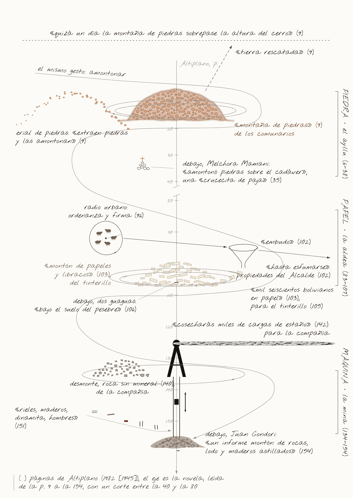{height=17cm}
:::

::: {custom-style="Pie de figura"}
**Figura 8.** *Tres montones*. Diagrama. Fuente: elaboración propia con asistencia de IA.
:::

El dibujo muestra, ante todo, posiciones. Los esquemas obligan a decidir lo que el texto deja abierto (desde dónde se mira, a qué escala, qué queda dentro y qué fuera), y cada una de esas decisiones deja ver la del narrador, que se queda fuera de la chujlla, en la tribuna del linchamiento o frente a las cumbres góticas. Cuando la decisión es del dibujante, como el cráneo o los mojones, la comparación con el texto y con el vocabulario aymara permite saber si se sostiene. Las operaciones del pastel, que suma, quita, mancha, raya y disuelve, repiten además las de la novela, donde se amontona, se despeja, se dejan «manchones» (ibid.: 60, 156), se escribe y uno se derrite. Fuão dice de la tijera y de la cola que esos instrumentos y materiales «no son neutros» (Fuão, 2011: 8). Leer con la mano supone, entonces, repetir operaciones más que ilustrar escenas, y viene a ser un manuaje de la lectura, tan táctil como la prosa que lee.

El trabajo tiene tres límites. El primero es el que advertía Hall, porque el corte, el *capriccio*, Bacon, la tectónica, Alexander, la collage, The Voidz y hasta la pelvis son maneras de ver ajenas al mundo narrado. Los dibujos hablan de la novela y no del ayllu, ni de la manera aymara de entender el espacio, que pedirían otras fuentes y otros autores, los de la historia que los aymaras, escribía Roberto Choque Canqui, «hace tiempo, hemos añorado por escribir» (Choque Canqui, 1978 [1974]: s. p.). Churata, que escribió desde Puno y desde La Paz en los mismos años que Botelho, muestra que en ese tiempo era posible otra mirada, aunque tampoco él se libra del exotismo cuando llama «juguetes cubistas» a las casas de Konkachi (Churata, 2017: 123). El segundo límite es ético, porque la inmersión seduce y un pastel puede embellecer la miseria o fabricar efigies; por eso la serie no dibuja el linchamiento ni el alma que el narrador declara cerrada. El tercero es de método, ya que el dibujo depende de los datos del texto y hereda sus silencios, que puede hacer visibles sin llegar a llenarlos.

Queda el montón. «Quizá un día la montaña de piedras sobrepase la altura del cerro», esperaban los comunarios (Botelho Gosálvez, 1982 [1945]: 9). La novela cumple esa profecía al revés, porque la montaña crece en el desmonte de la mina y en el «informe montón» que sepulta a Juan Condori (ibid.: 154). El dibujo no repara lo que la novela deja caer al foso. A lo sumo, como una *décollage* que despega lo que la memoria pegó, puede impedir que el foso se cierre del todo. Si en Jatun-Kolla habitar es despejar piedras, leer *Altiplano* con la mano es, quizá, volver a amontonarlas para ver qué queda debajo.

## Declaraciones finales

**Conflicto de intereses.** El autor declara no tener conflictos de intereses.

**Declaración de uso de inteligencia artificial.** a) *Herramientas*: Claude (Anthropic), ChatGPT y Codex (OpenAI), asistentes de IA generativa. b) *Alcance*: se emplearon en la exploración bibliográfica, la transcripción y paginación de fuentes digitalizadas, la localización y el cotejo de citas con su página, el contraste de pasajes de la novela, la revisión conceptual y la redacción de borradores, el diseño y trazado de los esquemas de encaje (figuras 1-6) y de los diagramas (figuras 7 y 8), y la búsqueda, el cotejo con sus fuentes y la preparación de las imágenes de dominio público (imágenes 1-5). c) *Rol*: el autor concibió la hipótesis original, diseñó la metodología de lectura tectónica, seleccionó las fuentes, decidió las interpretaciones, dirigió y revisó la redacción y es autor exclusivo de los pasteles al óleo que sustentan la investigación; asume la plena responsabilidad intelectual por la versión final del manuscrito.

## Bibliografía

Alexander, Christopher; Ishikawa, Sara y Silverstein, Murray (1977). *A Pattern Language. Towns, Buildings, Construction*. Nueva York: Oxford University Press.

Bachelard, Gaston (1978 [1942]). *El agua y los sueños. Ensayo sobre la imaginación de la materia*. México: Fondo de Cultura Económica.

Bachelard, Gaston (1983 [1957]). *La poética del espacio*. México: Fondo de Cultura Económica.

Barnadas, Josep M. (1978 [1975]). *Apuntes para una historia aymara*. 2.ª ed. La Paz: CIPCA (Cuadernos de Investigación, 6).

Bertonio, Ludovico (2011 [1612]). *Transcripción del vocabulario de la lengua aymara*. La Paz: Radio San Gabriel (1993) e ILLA-A (ed. digital).

Botelho Gosálvez, Raúl (1982 [1945]). *Altiplano*. 7.ª ed. La Paz: Librería Editorial Juventud.

Cárcamo Pino, Mauricio Arnoldo (2019). "Thinking and Intelligence in the Architectural Design. A Review from Language, Graphuage and Manuage". En Carlos Luis Marcos Alba (ed.), *Graphic Imprints. The Influence of Representation and Ideation Tools in Architecture. EGA 2018*. Cham: Springer: 1411-1423.

Cárcamo Pino, Mauricio Arnoldo (2025a). "Madera, herramientas y manuaje. Notas para una ontología evolutiva del diseñar". *Revista Arteoficio*, 21: 5-12. https://doi.org/10.35588/nn3v3487

Cárcamo Pino, Mauricio Arnoldo (2025b). "Oralitura/literatura y manuaje/lenguaje: una revisión por reescritura". *Revista Chilena de Literatura*, 112: 233-264.

Choque Canqui, Roberto (1978 [1974]). "Prólogo". En Josep M. Barnadas, *Apuntes para una historia aymara*. 2.ª ed. La Paz: CIPCA: s. p.

Churata, Gamaliel (2007 [1957]). *El pez de oro (Retablos del Laykhakuy)*. Versión digital de Rolando Diez de Medina. La Paz.

Churata, Gamaliel (2017). *Textos esenciales*. Recopilación y edición de Wilmer Kutipa Luque. Tacna: Perro Calato Ediciones.

Cornejo Polar, Antonio (2003 [1994]). *Escribir en el aire. Ensayo sobre la heterogeneidad socio-cultural en las literaturas andinas*. 2.ª ed. Lima y Berkeley: CELACP y Latinoamericana Editores.

Dean, Carolyn (2010). *A Culture of Stone: Inka Perspectives on Rock*. Durham y Londres: Duke University Press.

Duviols, Pierre (1979). "Un symbolisme de l'occupation, de l'aménagement et de l'exploitation de l'espace: le monolithe «huanca» et sa fonction dans les Andes préhispaniques". *L'Homme*, 19(2): 7-31.

Frampton, Kenneth (1995). *Studies in Tectonic Culture: The Poetics of Construction in Nineteenth and Twentieth Century Architecture*. Ed. John Cava. Cambridge, MA y Londres: MIT Press.

Fuão, Fernando Freitas (2011). *A collage como trajetória amorosa*. Porto Alegre: Editora da UFRGS.

Garrington, Abbie (2013). *Haptic Modernism: Touch and the Tactile in Modernist Writing*. Edimburgo: Edinburgh University Press.

Guaman Poma de Ayala, Felipe (1615). *Nueva corónica y buen gobierno*. Manuscrito GKS 2232 4º. Copenhague: Det Kgl. Bibliotek. Edición digital: https://poma.kb.dk/permalink/2006/poma/info/es/frontpage.htm

Hall, Edward T. (1973 [1966]). *La dimensión oculta: enfoque antropológico del uso del espacio*. Madrid: Instituto de Estudios de Administración Local.

Ingold, Tim (2013). *Making: Anthropology, Archaeology, Art and Architecture*. Londres y Nueva York: Routledge.

Julian Casablancas+The Voidz (2014). *Tyranny* [álbum]. Cult Records. Pista 6, «Father Electricity».

Le Guin, Ursula K. (2021 [1986]). "La teoría de la bolsa de transporte de la ficción". Trad. Kamen Nedev y José Pérez de Lama. Biblioteca Anarquista. https://es.theanarchistlibrary.org

Lundberg, Simon (2019). *Architecture as Image*. Proyecto de grado en Arquitectura, nivel avanzado. Estocolmo: KTH, TRITA-ABE-MBT-19132.

Martin, Richard (2014). *The Architecture of David Lynch*. Londres y Nueva York: Bloomsbury Academic.

Monteys, Xavier y Fuertes, Pere (2001). *Casa collage. Un ensayo sobre la arquitectura de la casa*. Barcelona: Gustavo Gili.

Pallasmaa, Juhani (2014 [2011]). *La imagen corpórea. Imaginación e imaginario en la arquitectura*. Trad. Carles Muro. Barcelona: Gustavo Gili.

Rivera Cusicanqui, Silvia (2010 [1984]). *«Oprimidos pero no vencidos». Luchas del campesinado aymara y qhechwa 1900-1980*. 4.ª ed. La Paz: WA-GUI.

Rodríguez, Malena y Rodríguez, Gabriel (2025). "Susto andino y violencia política". En Eloísa Paz y alfonso borragán (dirs.), *Susto al susto*. La Paz: A ediciones: 43-61.

Scott, James C. (2020 [1998]). *Seeing Like a State: How Certain Schemes to Improve the Human Condition Have Failed*. New Haven y Londres: Yale University Press.

Seguí de la Riva, Javier (2010). *Ser dibujo*. Madrid: Mairea Libros y Escuela Técnica Superior de Arquitectura de Madrid.

Spedding, Alison (2025). "Piedras en el camino". En Eloísa Paz y alfonso borragán (dirs.), *Susto al susto*. La Paz: A ediciones: XIII-XXIII.

Squier, Ephraim George (1877). *Peru: Incidents of Travel and Exploration in the Land of the Incas*. Nueva York: Harper & Brothers.

The Voidz (2018). *Virtue* [álbum]. Cult Records y RCA Records. Pistas 3, «Pyramid of Bones», y 7, «All Wordz Are Made Up». Letra según el librillo de la edición japonesa (Sony Music Labels, SICP 5689).

Vázquez Ramos, Fernando Guillermo; Dias Ribeiro, Carlos Eduardo; Quedas Campoy, Carlos y Ferreira de Paula, Franklin Roberto (2023). "Reflexões sobre a construção histórica do conceito de espaço: uma aproximação". *Risco. Revista de Pesquisa em Arquitetura e Urbanismo*, 21: 1-18. https://doi.org/10.11606/1984-4506.risco.2023.187844

Zavaleta Mercado, René (1986). *Lo nacional-popular en Bolivia*. México: Siglo XXI.
