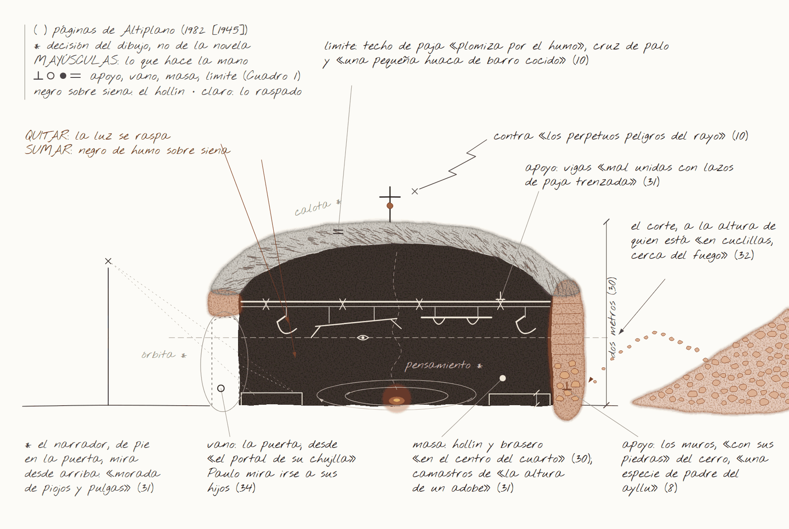
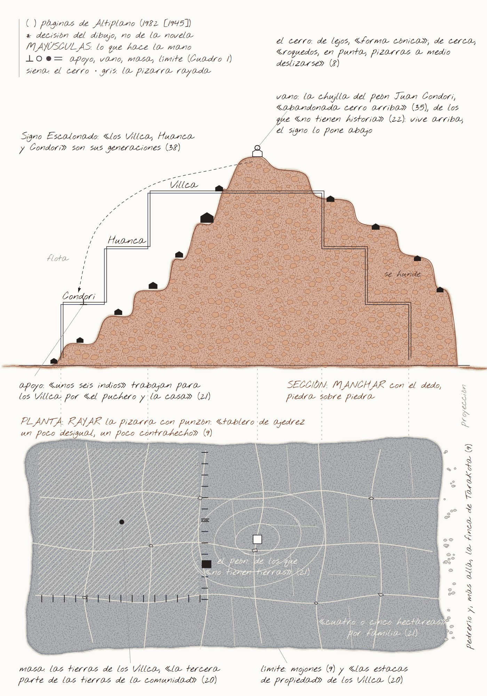
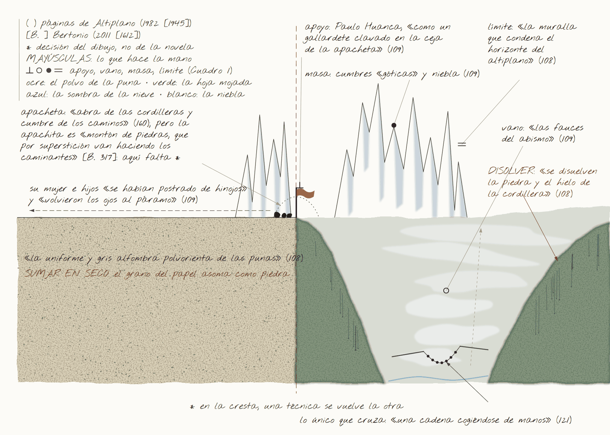
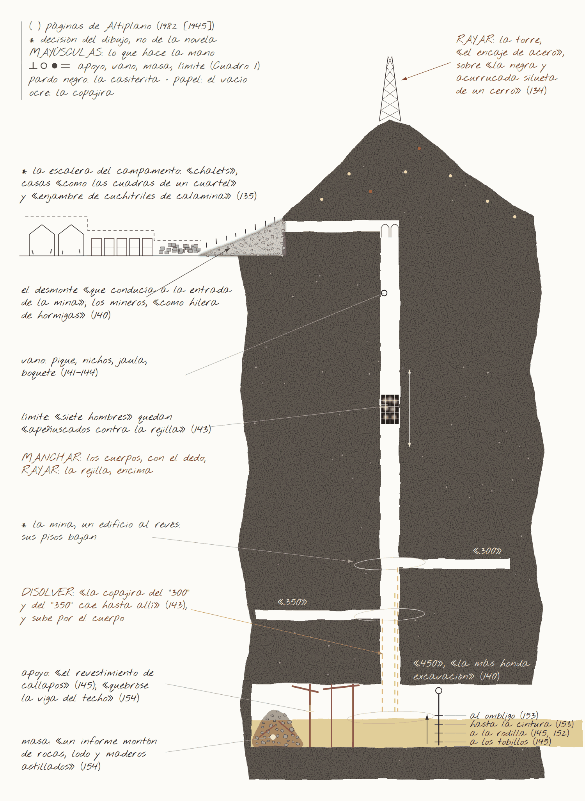
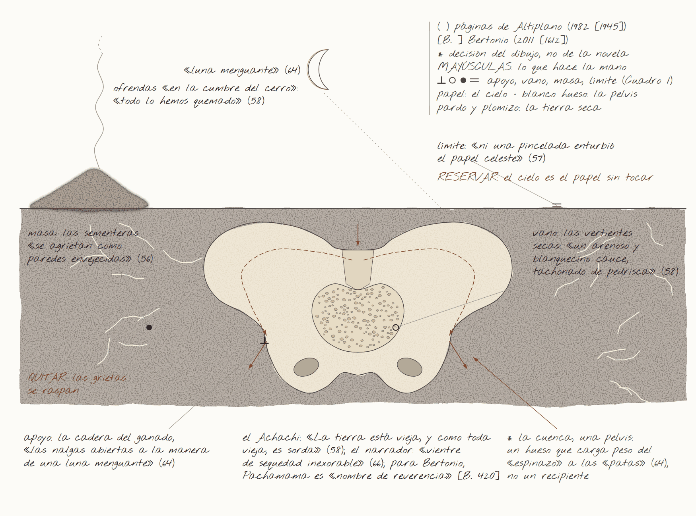
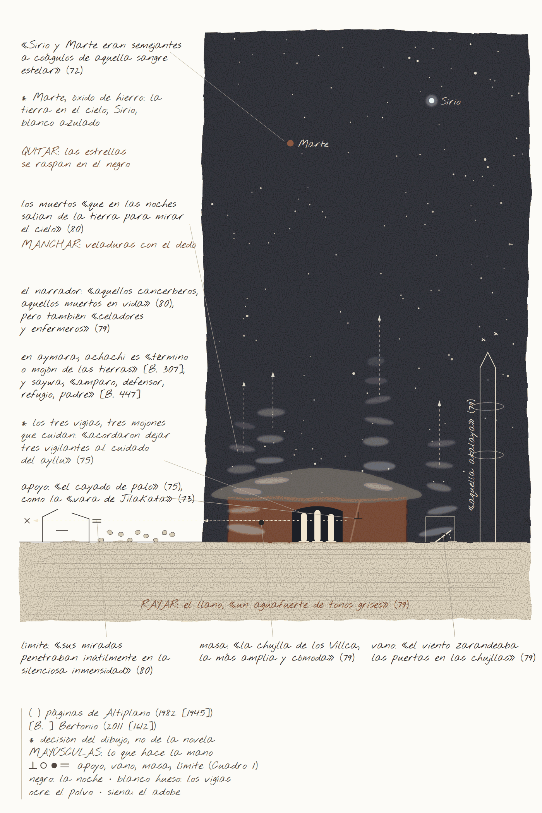

# Guía de los seis pasteles

Para «Cosecha de piedras: el ayllu, el Estado y la mina. Dibujando *Altiplano* de Raúl Botelho Gosálvez». Versión final, 11 de octubre de 2026.

## Para qué sirve esta guía

El artículo analiza seis pasteles al óleo como herramientas de lectura. Hoy publica, en las figuras 1 a 6, el **esquema de encaje** de cada uno: el trazado que fija la composición. Los pasteles están por hacer, y sus escaneos reemplazarán a los esquemas.

Esta guía deriva cada pastel del texto de la novela, con el mismo método del artículo, para que no partas de cero:

- **la observación y la disección ya están hechas:** los pasajes con su página y las cuatro funciones de cada escena (apoyo, vano, masa y límite), las mismas del Cuadro 1;
- **el ensamblaje y la inmersión te tocan a ti:** aquí van una propuesta de composición, una paleta y una secuencia técnica por figura.

Nada de esto es un modelo que haya que copiar. Si al dibujar aparece otra cosa, síguela y anótala: ese desvío es justo lo que el plano (3) del artículo tendrá que contar cuando el pastel exista (sección 5).

La numeración es la del artículo: el Castillete es la Figura 4, la Pelvis la 5 y el Centinela la 6. Si quieres explorar antes con GPT Image 2, en `analisis/esquemas/guias/` hay guías de composición sin texto. Esas exploraciones no se publican.

## 1. Materiales

| Qué | Recomendación | Para qué |
|---|---|---|
| Pastel al óleo | Una gama blanda (tipo Sennelier) para empastes y fundidos, más una media o de estudiante (Neopastel, Pentel, Mungyo) para las capas de fondo | Los blandos cubren y se esgrafían bien; los duros dan línea |
| Soporte | Papel de acuarela de 300 g/m², grano fino o medio, o cartón gris con gesso. **Para la Figura 5 (la Pelvis), papel celeste o gris azulado** | El papel de acuarela resiste el solvente. El gesso da diente para muchas capas |
| Formato | A3 (29,7 × 42 cm) si tienes tiempo; A4 si vas con prisa. El mismo formato en toda la serie | Una escala común hace legible la serie |
| Solvente | Aguarrás sin olor (tipo Gamsol), pincel plano y bastoncillos de algodón. Alternativa: aceite de bebé | Veladuras (figuras 3, 4 y 6) |
| Herramientas para quitar materia | Cúter o bisturí, espátula de paleta, clavo o punzón, mondadientes, aguja de tejer | Esgrafiado e incisión (figuras 1, 2, 4 y 5) |
| Piedras reales | Tres o cuatro piedras planas con textura y papel fino para frotar | Frotado de las piedras del cerro (figuras 1 y 2) |
| Otros | Cinta de papel para enmarcar el borde, trapo, papel cristal (*glassine*), cuaderno de bocetos y lápiz o carbonilla | Bordes limpios, protección y miniaturas previas |

El pastel al óleo **no seca nunca del todo**. Guarda cada dibujo con papel cristal encima y no lo apiles sin protección. Hay fijadores para pastel al óleo (por ejemplo, el de Sennelier), pero no hacen falta si escaneas pronto.

## 2. Siete técnicas, siete operaciones de la novela

El artículo sostiene que leer con la mano es **repetir operaciones**, no ilustrar escenas. Cada técnica repite una operación de la novela:

| Técnica | Cómo se hace | Operación de la novela que repite | Figuras |
|---|---|---|---|
| **Empaste** | Capas gruesas con presión, sin fundir, piedra a piedra | Amontonar: la cosecha de piedras (p. 9), las pircas | 1, 2, 4 |
| **Esgrafiado** | Capa clara debajo y oscura encima; se raspa con punta o cúter para que aparezca la clara | Despejar, extraer: sacar la luz de la masa como se saca la piedra de la tierra | 1, 4 |
| **Incisión** | Líneas finas con un punzón sobre la cera | Escribir e inscribir: el catastro, el mojón, la estaca | 2, 4 |
| **Fundido con el dedo** | Mezclar y arrastrar con la yema, sin línea previa | Los «manchones» de las rodillas en la rogativa (p. 60); el manuaje que menos se parece a la escritura | 3, 4, 6 |
| **Veladura con solvente** | Pintar sobre el pastel con un pincel mojado en aguarrás: se disuelve y chorrea | Derretirse: Paulo «como muñeco de cera» (p. 123); el agua de la mina | 3, 4 |
| **Reserva** | Dejar el papel desnudo, sin tocar | La sequía como ausencia: «Ni una pincelada enturbió el papel celeste» (p. 57) | 5 |
| **Frotado** | Papel fino sobre una piedra real, frotado con el pastel de canto; se recorta y se pega, o se frota directo si el soporte es delgado | Hacer muros con las piedras del cerro padre (p. 8): la textura la pone la piedra, no la mano que imita | 1, 2 |

## 3. El ciclo de trabajo de cada figura

Es el ciclo de Lundberg que sigue el artículo. Para cada figura, en este orden:

1. **Relectura (10 minutos).** Lee los pasajes de la ficha y subraya materiales, colores, luz y medidas.
2. **Disección (15 minutos).** Haz tres o cuatro miniaturas de 5 × 7 cm con lápiz o carbonilla, cada una sobre una relación: dónde están el apoyo, el vano, la masa y el límite.
3. **Ensamblaje (15 minutos).** Haz una miniatura de composición que junte los elementos de la ficha. Parte del esquema de encaje si te sirve, o descártalo. Antes de fijar nada, prueba las piezas unas junto a otras: Fuão sitúa las decisiones en el «intervalo» entre recortar y pegar, «antes de que la cola las fije» (Fuão, 2011: 8, 52). Y cada analogía (el cráneo, la pelvis, el edificio al revés) necesita «una referencia explícita» en el texto (ibid.: 53).
4. **Inmersión (de 1 a 3 horas).** Haz el pastel definitivo. Empieza por la capa de fondo y deja para el final los puntos de luz y las incisiones.
5. **Registro (10 minutos).** Fotografía cada etapa con el móvil y anota en el cuaderno qué decidiste, qué no salió como esperabas y qué descubriste. Anota también, junto al trazo, lo que hizo la mano: raspar, empastar, disolver. El artículo toma esa costumbre de los dibujos de Gordon Cullen para Lubetkin, que incluían «personas haciendo cosas» (Monteys y Fuertes, 2001: 132). De esas notas sale el plano (3).

## 4. Las seis fichas

### Figura 1. *Cráneo/nido*: sección de la chujlla de los Huanca

- **Pasajes.**
  - p. 8: el cerro «padre», con cuyas piedras «han hecho los cimientos y paredes de las chujllas».
  - p. 10: las chozas como «verrugas en la piel sarmentosa del altiplano»; el techo de paja «plomiza por el humo», con cruz y «una pequeña huaca de barro cocido».
  - pp. 29-32: los telares abandonados; la chujlla de dos metros, paredes «renegridas por el hollín», brasero en el centro, camastros de «apenas la altura de un adobe», herramientas colgadas de las vigas, charango de caparazón de quirquincho; la «mecha de sebo»; la «cinta bermeja del resplandor del fogón»; el «aire pesado, oloroso a boñiga quemada».
  - p. 34: el portal de la despedida.
- **Disección.**
  - Apoyo: los muros de piedra y las vigas atadas con paja.
  - Vano: la puerta, el único.
  - Masa: el hollín, el brasero y los camastros.
  - Límite: el techo de paja, con la cruz y la huaca.
- **Ensamblaje.** Un corte transversal visto desde la altura de una persona en cuclillas junto al fuego. El contorno del corte toma el perfil de un cráneo: la bóveda de paja como calota, la puerta como órbita, el fuego en el lugar del pensamiento. Fuera, a un lado, la ladera del cerro de donde salen las piedras de los muros.
- **Formato.** Apaisado o cuadrado.
- **Paleta.**
  - Negro humo y siena tostada para el hollín.
  - Ocre y tierra para el adobe y la piedra.
  - Gris plomizo para la paja.
  - Rojo bermellón y amarillo para el fuego.
  - Un toque de rojo y oro de kantuta en el umbral (p. 10).
- **Luz.** De noche, con una sola fuente cálida y baja: el brasero y la mecha de sebo. Todo lo demás, sombra.
- **Secuencia técnica.**
  1. Fondo de ocre claro y amarillo, que será la luz escondida.
  2. Encima, una capa gruesa de negro y siena en todo el interior.
  3. Esgrafiado: las vigas, las hoces, el yugo, el arado y el caparazón aparecen raspando la capa oscura.
  4. Los muros, en empaste o con frotado de piedras reales.
  5. El humo, con el dedo.
  6. El fuego, al final, en empaste puro.
- **Qué observar.** Desde dentro, ¿la chujlla sigue pareciendo una de las «verrugas en la piel sarmentosa del altiplano» que ve el narrador desde fuera (p. 10), o aparece como caja de herramientas y lugar de reposo? ¿El perfil de cráneo se impone o sale forzado?
- **Qué evitar.** Dibujar los «hondos sueños paganos y revolcones amorosos» que el narrador proyecta en los camastros (p. 31). El artículo dice que el dibujo **no** entra en el alma que el narrador declara cerrada (p. 65).

### Figura 2. *Signo Escalonado frente al mapa*: el cerro de Jatun-Kolla en sección y en planta

- **Pasajes.**
  - p. 6: las chujllas de las familias antiguas «han trepado en los riscos del cerro»; la «rojiza peñería»; la «llanura amarillosa, parda»; los «kollis verdinegros».
  - p. 9: el «tablero de ajedrez un poco desigual, un poco contrahecho»; los mojones.
  - pp. 20-23: Pedro Villca «empotró en el suelo del ayllu las estacas de propiedad»; la jerarquía de las familias y de sus historias.
  - p. 35: el peón Condori recibe «una chujlla que estaba abandonada cerro arriba».
  - pp. 36-38: Kero-Pata: títulos, papel sellado, la casa de hacienda frente a la iglesia; «las generaciones del Signo Escalonado».
  - p. 163: «Signo sagrado de Tiwanaco».
- **Disección.**
  - Apoyo: los peones que sostienen a los Villca (p. 21).
  - Vano: el salto entre escalones, donde quedan los que «no tienen historia».
  - Masa: la tierra acumulada.
  - Límite: estacas, mojones y títulos.
- **Ensamblaje.** Dos proyecciones del mismo cerro en una sola hoja, como en el sistema diédrico:
  - arriba, la **sección** escalonada, con las chujllas en sus escalones;
  - abajo, la **planta**: el tablero contrahecho, los mojones, las estacas y, en un borde, la hacienda frente a la iglesia;
  - entre ambas, líneas de proyección finas.

  La chujlla abandonada del peón va en un escalón alto, marcada con otro color. Es el dato que rompe el esquema del narrador.
- **Formato.** Vertical.
- **Paleta.**
  - Rojizos y sienas para la peñería.
  - Amarillo pardo para la llanura.
  - Verde negro para los kollis.
  - Para la planta, un color frío (gris o azul pizarra) que la separe de la sección.
- **Luz.** De día y cenital, casi sin sombras: la luz del plano.
- **Secuencia técnica.**
  1. Fondo claro en la mitad inferior y cálido en la superior.
  2. La sección por **empaste**, bloque a bloque, como quien apila piedras (aquí sirve el frotado).
  3. La planta, cubierta con una capa uniforme y después **incidida** con punzón: la cuadrícula, los mojones, las estacas.
  4. Las líneas de proyección, incididas también.
- **Qué observar.** ¿La escalera social cabe en la pendiente o se rompe? ¿Qué pasa en la hoja cuando el mito (la sección) y el mapa (la planta) se hacen con el mismo pastel y la misma mano?
- **Qué evitar.** Una pirámide limpia y simétrica que confirme el diagrama de clases del narrador. La hipótesis es que no encaja.

### Figura 3. *Umbral de la apacheta*: la ceja de la cordillera y la fauce del yunga

- **Pasajes.**
  - p. 33: la bendición: «que en las apachetas no les detenga el Supaya».
  - p. 108: «la muralla que condena el horizonte»; el horizonte «estrangulado».
  - p. 109: Paulo «como un gallardete clavado en la ceja de la apacheta»; la familia de rodillas; la «fauce del yunga», que deglute «una muselina de vapor fragante, como espumosa baba»; las cumbres «semejantes a fantásticas construcciones góticas»; el «confín violeta del atardecer»; las cinco de la tarde.
  - pp. 110-111: el «angosto pretil ceñido a la roca»; la «ligera pincelada amarilla».
  - p. 121: el puente de monos.
  - p. 160: el glosario: «abra de las cordilleras y cumbre de los caminos».
- **Disección.**
  - Apoyo: el cuerpo de Paulo como poste.
  - Vano: la fauce del abismo.
  - Masa: las cumbres y la niebla.
  - Límite: la cresta, la muralla del horizonte.
- **Ensamblaje.** La hoja se parte por la cresta:
  - a un lado, la puna, seca, gris y violeta, con un horizonte recto;
  - al otro, el yunga, húmedo y verde, con dos paredes que convergen como una boca;
  - en la cresta, Paulo como un trazo vertical con el poncho al viento, y la familia arrodillada;
  - abajo, en el río del yunga, la cadena de monos como único puente.

  La novela **no** pone piedras en su apacheta. Si decides añadirlas, es tu proyección, y conviene decirlo en el pie o en el texto.
- **Formato.** Apaisado.
- **Paleta.**
  - Puna: gris polvo, violeta de atardecer y ocre pálido.
  - Yunga: verdes húmedos, blanco de vapor y un toque de amarillo.
  - Cumbres: blanco con azul frío.
- **Luz.** Las cinco de la tarde, rasante, desde el lado de la puna.
- **Secuencia técnica.**
  1. El lado de la puna, en **seco**: pastel de canto y con presión sobre papel de grano, para que el grano blanco asome como piedra. No fundas nada.
  2. El lado del yunga, con capas de verde fundidas.
  3. Veladura con **solvente**: un pincel con aguarrás que disuelva y haga chorrear el pastel, sin miedo a que corra.
  4. En la cresta, el cruce de las dos maneras: es el punto de máxima tensión.
  5. Paulo, al final, en empaste oscuro.
- **Qué observar.** ¿El paso de lo seco a lo húmedo se lee como otro paisaje o como un cambio de estado de la materia? ¿El puente de monos pesa en la composición o queda como anécdota?
- **Qué evitar.** La postal de los Yungas. El narrador los ve con «histeria de bosques vírgenes» (p. 108), y el dibujo no tiene por qué heredar ese exotismo.

### Figura 4. *El castillete y la caída al plano 450*

- **Pasajes.**
  - p. 134: el cerro «jorobado»; «el encaje de acero de la torre de un andarivel»; las luces, «semejante a un prendedor de topacios y rubíes»; la máquina «de tres pesados y anchos martillos».
  - p. 135: el campamento escalonado: chalets, casas en fila, cuchitriles.
  - p. 136: «la noche del subsuelo es eterna»; el agua «sulfurosa y amarillenta»; la gruta de la Virgen junto a la pila.
  - p. 140: el desmonte; las impresiones digitales.
  - pp. 141-145: los «dos enormes nichos»; las jaulas; los siete hombres «apeñuscados contra la rejilla»; la caída; los «montones de cascotes»; el «boquete»; las «costillas zafadas como surcos».
  - pp. 151-154: «rieles, maderos, dinamita, hombres»; el agua a la rodilla, a la cintura y al ombligo; el disparo; la viga que se quiebra; el «informe montón de rocas, lodo y maderos astillados».
- **Disección.**
  - Apoyo: los callapos y la viga del techo, que se quiebra.
  - Vano: el pique, los nichos, la jaula y el boquete.
  - Masa: el agua, los cascotes y el montón.
  - Límite: la rejilla y la línea del agua sobre el cuerpo.
- **Ensamblaje.** Un corte vertical en tres partes:
  - arriba, la torre como un encaje contra la noche y, junto a ella, el desmonte, que es la «montaña de piedras» que soñaban los comunarios (p. 9) cumplida como escombro;
  - en la superficie, el campamento escalonado;
  - debajo, el pique con los niveles «300», «350» y «450» como los pisos de un edificio al revés, la jaula con siete cuerpos y, en el fondo, la galería inundada con el derrumbe.
- **Formato.** Vertical y alargado; sirve una tira de 20 × 60 cm.
- **Paleta.**
  - Negros y sombra.
  - Óxido de los rieles.
  - Amarillo azufre del agua de la mina (copajira).
  - Puntos de topacio y rubí para las luces.
  - Carne apagada para los cuerpos.
- **Luz.** Puntos pequeños y duros (lámparas de carburo, bombillas) y todo lo demás a oscuras.
- **Secuencia técnica.**
  1. Fondo claro (ocre o amarillo) y, encima, negro en toda la roca.
  2. La torre **incidida** como un encaje.
  3. Los cuerpos de la jaula **con el dedo**, sin línea.
  4. La rejilla **esgrafiada encima** de los cuerpos: el marco que aísla.
  5. En el fondo, una banda de amarillo azufre disuelta con **solvente** que suba por las figuras.
  6. El montón, en empaste grueso, al final.
- **Qué observar.** ¿La mina se lee como lo contrario del ayllu o como su doble invertido? ¿El desmonte en lo alto se reconoce como la montaña de piedras del principio?
- **Qué evitar.** Dibujar el disparo o el cadáver. La violencia está en la estructura: la jaula, el agua, la viga.

### Figura 5. *Pelvis telúrica / Pachamama sorda*

- **Pasajes.**
  - p. 56: las sementeras «se agrietan como paredes envejecidas».
  - p. 57: «Ni una pincelada enturbió el papel celeste y deslumbrador del cielo»; el crepúsculo como «dantesco brasero».
  - p. 58: las vertientes secas, «un arenoso y blanquecino cauce, tachonado de pedrisca»; las ofrendas quemadas en el cerro; «La tierra está vieja, y como toda vieja, es sorda».
  - p. 63: la luna, «hinchada como una nube de fuego blanco».
  - p. 64: las vacas famélicas, con «las nalgas abiertas a la manera de una luna menguante».
  - p. 66: «La Pacha Mama, sorda, vieja, extenuada».
  - p. 72: la luna menguante «tenía sangre».
- **Disección.**
  - Apoyo: la cadera ósea, la estructura que carga.
  - Vano: la abertura pélvica, que es el cauce seco.
  - Masa: la tierra agrietada.
  - Límite: el cielo sin trazo.
- **Ensamblaje.** La cuenca de las vertientes secas vista desde arriba o en escorzo, dibujada como una pelvis de ganado, con dos alas y una abertura central. En el cielo, una luna menguante que repite la curva de la cadera. Al fondo, el cerro pequeño con un hilo de humo de las ofrendas.
- **Formato.** Apaisado.
- **Paleta.**
  - Cielo: **no se toca**. Es el papel celeste o gris azulado, que hace literal la metáfora de la p. 57.
  - Tierra: sombra, siena y «plomizo y mineral» (p. 66).
  - Hueso: blanco roto y marfil.
  - Un solo acento rojo, en la luna o en el borde del cielo («tenía sangre», p. 72).
- **Luz.** Mediodía blanco o luna llena de «fuego blanco». Luz dura, sin sombra que proteja.
- **Secuencia técnica.**
  1. Enmascara el cielo con cinta y no lo toques.
  2. La tierra, en capas de sombra.
  3. La pelvis en blanco hueso, en empaste.
  4. Las grietas, por **raspado**, hasta que aparezca el papel.
  5. La luna, como la pelvis, por reserva o con muy poco material.
- **Qué observar.** ¿La pelvis se lee como estructura que carga o vuelve a leerse como sexo, el tropo del narrador? Si pasa lo segundo, anótalo: también cuenta como resultado.
- **Qué evitar.** Cualquier cuerpo femenino. La operación consiste justo en desplazar la metáfora sexual hacia la estructura.

### Figura 6. *El centinela de la resistencia*: los tres vigías del ayllu vacío

- **Pasajes.**
  - pp. 23-24: el bastón de keñua de Pedro Villca; la vara de Jilakata.
  - p. 72: el cerro como «Achachila»; Sirio y Marte, «semejantes a coágulos de aquella sangre estelar».
  - p. 73: Paulo sube al estrado de adobes con la vara.
  - p. 75: Braulio Choquehuanca y su cayado; los «tres vigilantes al cuidado del ayllu».
  - p. 79: el ayllu vacío, con puertas zarandeadas y polvo en los rincones; los tres vigías en la chujlla de los Villca, «celadores y enfermeros de un solar histérico, infecundo y trágico»; los buitres en el campanario, «aquella atalaya»; el sol «como una ascua».
  - p. 80: los muertos que «en las noches salían de la tierra para mirar el cielo»; «cancerberos», «muertos en vida».
- **Disección.**
  - Apoyo: los cuerpos-poste y el cayado.
  - Vano: la puerta de la chujlla vacía.
  - Masa: la casa de los Villca.
  - Límite: la mirada sobre la inmensidad.
- **Ensamblaje.** Un nocturno con tres figuras verticales en el vano de la casa más grande del ayllu vacío, tratadas como postes o mojones: apoyos, no héroes. A un lado, un cayado apoyado. Al fondo, el campanario con los buitres, como una vigía opuesta. Del suelo suben formas pálidas: los muertos que salen a mirar el cielo. Horizonte bajo y cielo enorme.
- **Formato.** Vertical.
- **Paleta.**
  - Azul noche y negro.
  - Ocre polvo para el suelo.
  - Dos estrellas rojas: Sirio y Marte.
  - Blancos muy velados para los muertos.
- **Luz.** Nocturna, sin luna o con muy poca. Las figuras se leen por su silueta.
- **Secuencia técnica.**
  1. El cielo, en capas de azul y negro fundidas con el dedo.
  2. La casa y el suelo, en empaste pardo.
  3. Las tres figuras, como trazos verticales gruesos y firmes.
  4. Los muertos, con **el dedo apenas cargado de blanco**, en veladura. También sirve el solvente.
  5. Las estrellas, al final, en un punto de empaste.
- **Qué observar.** ¿Los vigías se leen como resistencia (cuidado, permanencia) o como ruina (los «cancerberos» del narrador, p. 80)? ¿Hacia dónde miran? El final de la novela tiene una «atalaya de la esperanza» desde la que nadie se atreve a mirar hacia abajo (p. 157).
- **Qué evitar.** El heroísmo: nada de puños alzados ni de poses épicas. El discurso de Braulio, de hecho, fracasa.

## 5. Después del pastel: reescribir el plano (3)

Cuando termines cada pastel, reescribe en el artículo el plano «(3) *Contraste*» de esa figura con lo que mostró el dibujo, no con lo que se esperaba. Solo eso puede llamarse hallazgo: el artículo advierte que las decisiones del esquema «no cuentan como hallazgos». Una plantilla posible:

> (3) *Contraste*. Al [operación: esgrafiar las vigas, disolver el yunga, incidir el catastro...], apareció [lo que viste], que el texto [no dice / dice de otro modo / contradice en la p. X]. La lectura [se confirma / se matiza / no se sostiene]: [consecuencia para la lectura de la novela].

Si un pastel desmiente la lectura, **no lo escondas**: un desmentido honesto vale más en el arbitraje que una confirmación forzada. Cuando ya no quede ningún esquema en el artículo, reescribe también las frases que hablan de ellos (secciones 1 y 2 y las conclusiones) y la declaración de IA. Si la revista elegida tiene un límite de extensión, lo que añadas tendrá que salir de otra parte.

## 6. Fotografiar e insertar las figuras

1. **Captura.** Escanea a 300 ppp como mínimo, o fotografía con luz de día difusa, sin flash, con el móvil paralelo a la hoja. Si puedes, pon al lado una carta de color o un papel blanco para corregir el color.
2. **Edición.** Recorta al borde del dibujo, corrige la perspectiva y exporta en JPG de alta calidad, de 2.000 a 3.000 píxeles de lado mayor. Si la revista pide TIF, exporta también en TIF.
3. **Archivo.** Guarda las imágenes como `articulo/figuras/figura_1.jpg` … `figura_6.jpg`, con la numeración del artículo.
4. **Inserción.** En `articulo/articulo_cosecha_de_piedras.md`, dentro de cada bloque de figura, cambia `figuras/figura_N.png` por `figuras/figura_N.jpg` y conserva el ancho. Para las figuras verticales usa `{height=18cm}`.
5. **Pie.** Sustituye «Esquema de encaje del pastel al óleo. Fuente: elaboración propia con asistencia de IA.» por el soporte, las medidas y el año. Por ejemplo: «Pastel al óleo sobre papel, 29,7 × 42 cm, 2026. Fuente: elaboración propia.»
6. **Regenerar.** Ejecuta `python3 articulo/generar_docx.py`.

Sube también los escaneos al canal `altiplano · pasteles` del atlas de Are.na, con el soporte, las medidas y el año.

## 7. Si el tiempo apremia

- **Serie exprés, en un día.** Seis pasteles A4 de 60 a 75 minutos cada uno, con 20 minutos previos de miniaturas por figura: unas 8 horas en total. Es una escala coherente con Lundberg, que dibujaba de 30 a 60 minutos por imagen.
- **Prioridad.** Si no llegan las seis, las que más sostienen el argumento son la 2 (el signo frente al mapa), la 4 (la mina como doble del ayllu) y la 1 (la chujlla). Con cuatro figuras habría que ajustar el texto y el Cuadro 1.
- **Plazo.** La decisión tomada es que el artículo lleve los escaneos de tus pasteles. Si los pasteles no llegan a tiempo, el artículo puede enviarse con los esquemas, como investigación en desarrollo. En ese caso, si la revista lo acepta, pregunta si podrás sustituirlos por las fotografías antes de la maquetación.
