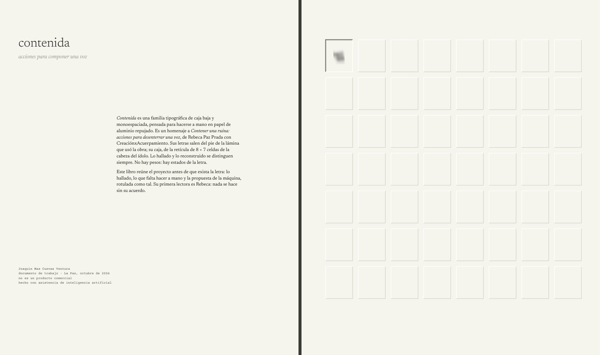
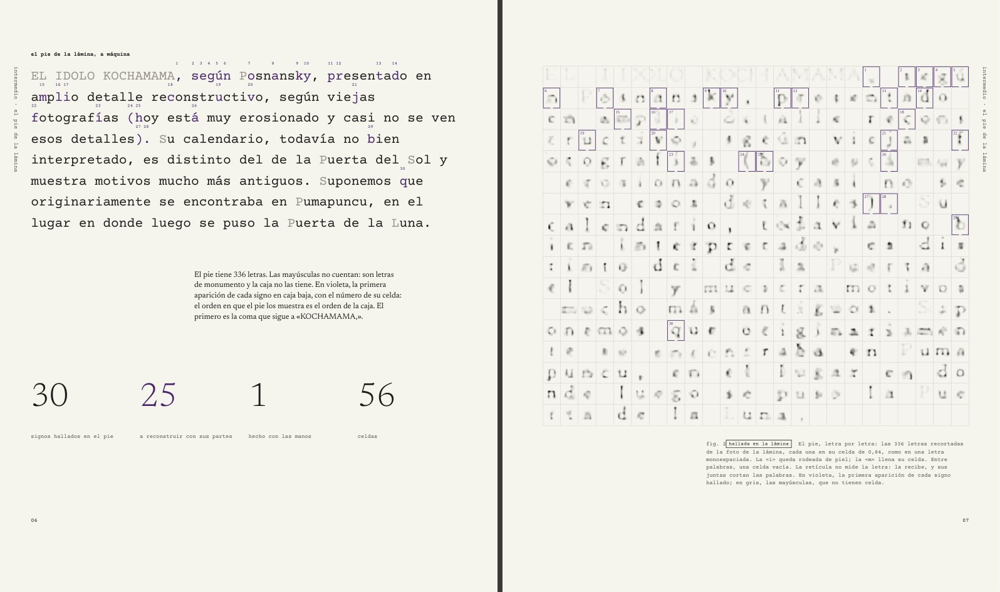
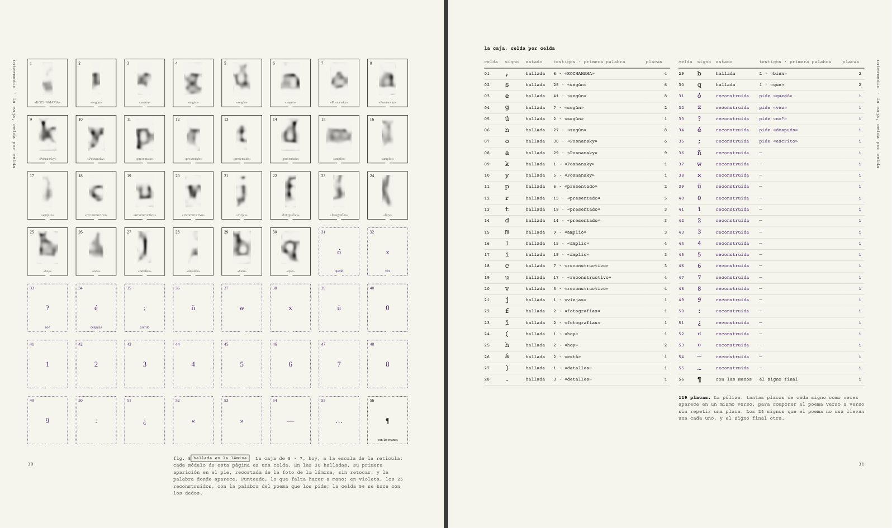
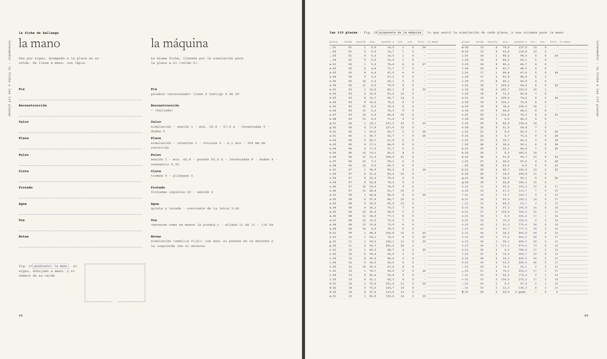
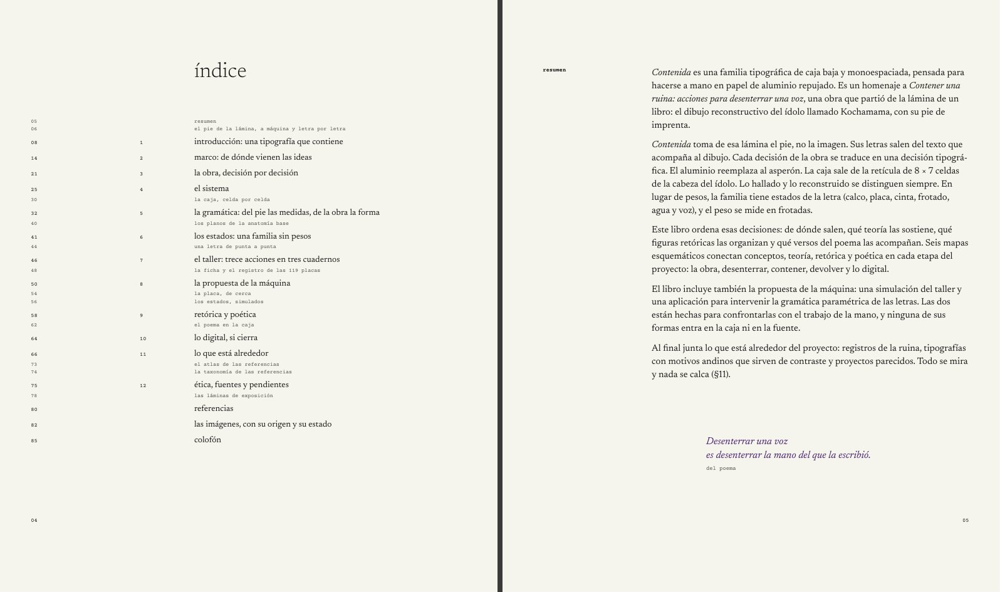
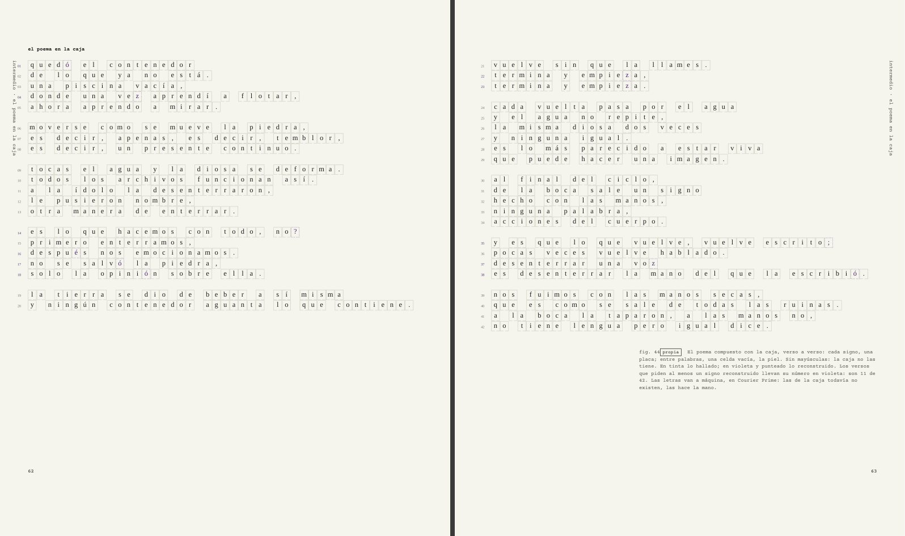
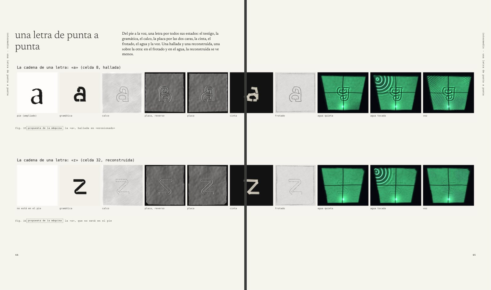

# El libro de *Contenida*

Un solo documento editorial con todo el proyecto: el informe de decisiones, los mapas, los planos, la taxonomía, las láminas, la propuesta de la máquina y lo que falta hacer a mano. Su primera lectora es Rebeca Paz Prada: es una propuesta, y nada de lo que propone se hace sin su acuerdo (Acción 0). Después, sirve a quien siga el proyecto en el taller.



| Archivo | Qué es |
|---|---|
| `contenida_libro.pdf` | **El libro, para leer en pantalla:** 210 × 250 mm, sobre el papel del proyecto, con tapa y contratapa (85 páginas, más las tapas) |
| `contenida_libro_imprenta.pdf` | El libro para la imprenta: papel blanco, 3 mm de sangre y marcas de corte (85 páginas) |
| `contenida_cubierta_imprenta.pdf` | La cubierta para la imprenta: el pliego con el lomo, en dos páginas: lo que va en tinta y las planchas de relieve seco y troquel |
| `imagenes.md` | Las 73 figuras con su página, de dónde salen en el repositorio y su estado |
| `muestras/` | Ocho dobles páginas en JPG |
| `armar.py` | Arma todo: `python3 tipografia/editorial/armar.py` |
| `libro.py`, `planas.py`, `cubierta.py`, `estilo.css` | Las piezas, las páginas compuestas, la cubierta y el sistema en CSS |
| `extraer_informe.js` | Saca el texto de `../informe/informe.js`: si el informe cambia, el libro cambia |
| `placas_de_cerca.py`, `imagenes/` | Tres placas de la simulación a su resolución de trabajo, para «la placa, de cerca» |

## Cómo se arma

```
cd tipografia/editorial && npm install        # una vez: Vivliostyle CLI 11.3.3
python3 tipografia/editorial/armar.py         # el libro para pantalla, imagenes.md y muestras/
python3 tipografia/editorial/armar.py --imprenta   # el libro y la cubierta para la imprenta
python3 tipografia/editorial/armar.py --sin-pdf    # solo .cache/libro/libro.html, para `npx vivliostyle preview`
```

Necesita Node, Python 3 con Pillow, NumPy y PyMuPDF, y Chromium (si no está el de Playwright, Vivliostyle baja el suyo; la variable `CHROMIUM` elige otro). `pyphen` corta las palabras en español; sin él, el texto va sin cortes. Las placas de cerca se rehacen con `python3 tipografia/editorial/placas_de_cerca.py` (medio minuto). Todo lo que se arma va a `.cache/`, que no entra en el repositorio.

## Las cinco referencias

| Referencia | Lo que tiene | Lo que toma el libro |
|---|---|---|
| **El libro con forma de guion** | Texto a máquina, fotos chicas con su código de tiempo y un índice en el margen | Lo que ya estaba escrito va a máquina (Courier Prime): el pie, los datos, los pies de figura. Cada capítulo abre con su índice al margen, con números de página. Los datos de la placa llevan su «código de tiempo»: `[ a.01 · celda 8 · sesión 1 · minuto 42,8 ]` |
| **«PAST (in)tense / future (im)PERFECT»** | Contraste de escala, columnas que se pisan y un bloque de mayúsculas espaciadas cortado por la retícula | El pie y el poema puestos en celdas, una letra por celda, con las palabras cortadas donde cae la retícula: «la piscina no mide la letra: la recibe, y sus juntas la cortan». Sin mayúsculas: la caja no las tiene. Las llamadas a otras páginas, con flecha y número |
| **El catálogo del festival de cine** | Fotogramas en una retícula modular, capítulos con mucho aire, columnas bilingües y un índice de nombres y páginas | Las galerías de láminas y planos, de a doce lugares (los que sobran quedan como celda vacía); los capítulos abren con tres filas de aire; la ficha a dos columnas, *la mano* y *la máquina*, como un texto bilingüe; los índices de la caja, de las 119 placas y de las imágenes |
| **El libro coreano sobre la vida cotidiana en Japón** | Objetos en blanco y negro sobre mucho blanco, columnas angostas y rótulos verticales en el borde | La placa como objeto, recortada sobre el papel; la columna de texto de 88 mm; el rótulo vertical en el margen de afuera de las páginas compuestas |
| **Dora Lazarevic, *Europe*** | Fotos arriba, una línea de carbonilla que cruza la doble página y rótulos verticales junto al lomo | «Una letra de punta a punta» cruza el lomo: la cadena de estados de la «a» y de la «z» va de un borde al otro. El trazo de carbonilla no se imita: el gesto de la mano no lo dibuja la máquina |

Lo que tienen en común —papel blanco roto, blanco y negro, retícula estricta, composición asimétrica, letra chica con márgenes amplios, los datos como parte del diseño— ya estaba en el proyecto. El libro lo lleva un paso más allá: **el libro es la caja.**

## El sistema

**Formato.** 210 × 250 mm: la página tiene la proporción de la celda, 0,84. Se encuaderna cosido, con lomo abierto, para que abra plano: dos piezas cruzan el lomo.

**Retícula.** La caja: 8 columnas × 7 filas de celdas de 19 × 22,619 mm (0,84), con juntas de 4 mm. Ocupa 180 × 182,3 mm; márgenes de 28 mm arriba, 39,7 abajo, 17 adentro y 13 afuera. La retícula no se espeja: todas las páginas son la misma caja. Una fila con su junta son seis líneas de texto (interlínea de 4,4365 mm). Las columnas, desde el borde izquierdo: c1 0 · c2 23 · c3 46 · c4 69 · c5 92 · c6 115 · c7 138 · c8 161 mm.

| Zona | Columnas | Qué va |
|---|---|---|
| Margen de notas | c1–c2 (42 mm) | El número de la sección, colgado; las llamadas a otras páginas; los lugares punteados; los pies |
| Aire | c3 | Nada; las tablas de tres o más columnas empiezan acá |
| Texto | c4–c7 (88 mm) | El informe, en Newsreader de 9,4 pt |
| Aire | c8 | Nada; las tablas anchas y las figuras llegan hasta acá |

**Letras.** Dos, con licencia SIL Open Font License, de `../laminas/fuentes/`:

| Uso | Letra | Cuerpo |
|---|---|---|
| Texto | Newsreader 400 | 9,4 pt sobre 4,4365 mm, en bandera, con cortes de palabra |
| Títulos de capítulo, número de capítulo | Newsreader 300 | 25 pt y 52 pt |
| Títulos de sección | Newsreader 500 | 9,4 pt |
| Versos | Newsreader 400 cursiva, violeta | 10,6 pt |
| A máquina: cabezas, números, pies, datos, el pie de la lámina, el poema en la caja, tablas de datos | Courier Prime | 5,5 a 16 pt |

No hay letra de mano. La Belle Aurore, la fuente de los mapas, imita una mano; el libro la deja donde está y no la suma: lo que se hace a mano se hace a mano, en los lugares punteados.

**Color.** Tinta (`#1d1c1a`) y violeta (`#4a2470`), la tinta del esténcil y de lo reconstruido. En pantalla, el papel es `#f6f4ee`; en imprenta, el papel lo pone el papel. El verde es solo luz: aparece en las fotos simuladas del agua y de la voz, nunca como tinta.

**Imágenes.** Cada figura lleva su número y su estado:

| Estado | Marco | Etiqueta |
|---|---|---|
| Propia | Sin marco | `propia` |
| Propuesta de la máquina | Punteado | `propuesta de la máquina`, punteada |
| Hallada en la lámina | Continuo | `hallada en la lámina` |
| Dominio público | Sin marco | `dominio público` |
| Pendiente de permiso o de la mano | Un lugar vacío, punteado en violeta | `pendiente`, en violeta |

Todo marco se abre abajo, en su punto más bajo: el desagüe. Las imágenes de la simulación van sin su título (lo dice el pie) y con su papel igualado al del libro. No hay fotos ni videos de la obra ni del cuerpo de Rebeca: su lugar queda punteado (fig. 3, en la página 8).

**Piezas.** La apertura de capítulo ocupa tres filas: el número, el título en caja baja y el índice del capítulo con sus páginas. Las secciones cuelgan su número en c1. La cabeza de página dice el capítulo y la sección; el folio va abajo, afuera. Las figuras anchas flotan arriba de la página; las que cierran un capítulo, y los mapas, van en su propia página. Las planas son páginas compuestas a mano en la retícula, con un rótulo vertical en el margen de afuera.

## El índice

| Pág. | | |
|---|---|---|
| 1 | | Portadilla, créditos, portada, índice |
| 5 | | Resumen |
| 6 | intermedio | El pie de la lámina, a máquina y letra por letra |
| 8 | 1 | Introducción: una tipografía que contiene |
| 14 | 2 | Marco: de dónde vienen las ideas |
| 21 | 3 | La obra, decisión por decisión |
| 25 | 4 | El sistema |
| 30 | intermedio | La caja, celda por celda |
| 32 | 5 | La gramática: del pie las medidas, de la obra la forma |
| 40 | intermedio | Los planos de la anatomía base |
| 41 | 6 | Los estados: una familia sin pesos |
| 44 | intermedio | Una letra de punta a punta |
| 46 | 7 | El taller: trece acciones en tres cuadernos |
| 48 | intermedio | La ficha y el registro de las 119 placas |
| 50 | 8 | La propuesta de la máquina |
| 54 | intermedio | La placa, de cerca; los estados, simulados |
| 58 | 9 | Retórica y poética |
| 62 | intermedio | El poema en la caja |
| 64 | 10 | Lo digital, si cierra |
| 66 | 11 | Lo que está alrededor |
| 73 | intermedio | El atlas y la taxonomía de las referencias |
| 75 | 12 | Ética, fuentes y pendientes |
| 78 | intermedio | Las láminas de exposición |
| 80 | | Referencias |
| 82 | | Las imágenes, con su origen y su estado |
| 85 | | Colofón |

El texto de los capítulos es el del informe de decisiones, sin cambios salvo tres frases (ver «Cómo seguir»). Lo nuevo son los intermedios: páginas compuestas que muestran lo que el informe solo cuenta.

## Las planas

| Plana | Página | Qué hace |
|---|---|---|
| La portadilla | 1 | La celda 1 con la coma de «KOCHAMAMA,», el primer signo hallado, recortada de la foto. Es lo que se ve por la puerta de la tapa |
| El pie de la lámina | 6–7 | A la izquierda, el pie a máquina, con la primera aparición de cada signo hallado y el número de su celda; a la derecha, las 336 letras de la foto, cada una en su celda de 0,84 |
| La caja, celda por celda | 30–31 | La caja de 8 × 7 a la escala de la retícula: en las 30 halladas, su primera aparición en el pie; punteado, lo que falta hacer. Al lado, el índice de la caja y la póliza |
| Los planos | 40 | Los once planos de la anatomía base, de a doce lugares |
| Una letra de punta a punta | 44–45 | La cadena de la «a» y de la «z» cruza el lomo |
| La ficha y las 119 placas | 48–49 | La ficha de hallazgo en blanco, para la mano, junto a la que llenó la máquina; y el registro de las 119 placas, con una columna para la mano |
| La placa, de cerca | 54–55 | La placa de la máquina, a la mitad, ya hecha; la de la mano, a tamaño real, por hacer |
| Los estados, simulados | 56–57 | Las ocho láminas de la simulación |
| El poema en la caja | 62–63 | El poema verso a verso, cada signo en su celda: así se compone con las placas. En violeta, los once versos que piden una letra reconstruida |
| El atlas y la taxonomía | 73–74 | R-09, con las imágenes de dominio público, y las otras nueve láminas |
| Las láminas de exposición | 78–79 | Las diecisiete láminas, de a doce lugares |

La tapa es la tapa de la caja (D4): sin título, las 56 celdas en relieve seco, sin tinta, y la celda 1 calada: por esa puerta se ve la coma de la página 1. El título va en el lomo y en la contratapa.













## Para la imprenta

`contenida_libro_imprenta.pdf` y `contenida_cubierta_imprenta.pdf` están en RGB, con sangre y marcas de corte. Antes de imprimir:

- **Tintas.** El libro está pensado a dos tintas: negro y un directo violeta, igualado en la imprenta con la tinta del esténcil. Las fotos simuladas del agua y de la voz piden color (el verde de su luz): o van a cuatro colores en esos pliegos, o se aceptan en dos tintas. Lo decide la prueba.
- **Papel.** Interior ahuesado sin estucar, de 100 a 120 g; tapa de cartulina sin estucar, de unos 300 g, que tome bien el relieve seco.
- **Cubierta.** Una plancha de relieve seco para las 55 celdas y un troquel de 19 × 22,6 mm en la celda 1, a 17 mm del lomo y 28 mm del borde de arriba (página 2 del PDF de la cubierta).
- **Lomo.** 7,5 mm para 85 páginas, a 0,15 mm por hoja: se confirma con el papel elegido. `cubierta.py` lo recalcula (`LOMO_POR_HOJA`).
- **Encuadernación.** Cosida, con lomo abierto, para que abra plano.

## Cómo seguir

- **El texto** sale del informe: se corrige `../informe/informe.js` y se vuelve a armar. Tres frases cambian para que hablen del libro y no del informe (`CAMBIOS_DE_TEXTO`, en `libro.py`); si el informe las cambia, el armado avisa.
- **Lo pendiente** está marcado en `planas.py` y `libro.py` con `vacio_texto`, `vacio_margen` y la placa de la mano (estado `permiso` o `mano`). Cuando exista lo que falta —el permiso de Rebeca, las placas de la mano, el frotado de la pared, la ficha llenada a mano—, el lugar punteado se cambia por la imagen con su estado.
- **Una plana nueva** se escribe en `planas.py` con `lb.plana([...])` y piezas puestas con `en(columna, fila, columnas, filas)`; se suma en `componer()`, en su lugar.
- **Lo que no se resolvió en CSS.** Vivliostyle no deja vaciar las figuras flotantes pendientes antes de una plana: por eso las figuras que cierran un capítulo van en su propia página. Las flechas se dibujan (no están en las fuentes) y la σ va en DejaVu Serif.

## La herramienta

El libro se compone en HTML y CSS y pasa a PDF con **[Vivliostyle](https://github.com/vivliostyle/vivliostyle-cli)** (CLI 11.3.3, núcleo 2.45.1; AGPL-3.0), que implementa CSS Paged Media y GCPM sobre Chromium: páginas con nombre, cajas de margen, cadenas para las cabezas, `target-counter()` para los números de página, figuras flotantes de página, escritura vertical, sangre y marcas de corte. Se eligió entre las herramientas libres que hay en GitHub (versiones vistas el 19.10.2026):

| Herramienta | Qué es | Por qué sí o por qué no |
|---|---|---|
| [Vivliostyle](https://github.com/vivliostyle/vivliostyle.js) | CSS Paged Media sobre Chromium | **Elegida.** Mantenida, con figuras flotantes de página, texto vertical en los márgenes y marcas de imprenta |
| [Paged.js](https://github.com/pagedjs/pagedjs) | Polyfill de CSS Paged Media en el navegador (MIT) | La misma idea; su última versión en npm, la 0.4.3, es de 2023 |
| [WeasyPrint](https://github.com/Kozea/WeasyPrint) | Motor propio, en Python (BSD) | Muy bueno para documentos; sin figuras flotantes de página ni escritura vertical |
| [Typst](https://github.com/typst/typst) | Lenguaje de composición propio (Apache-2.0) | Tipografía excelente, pero obliga a reescribir todo fuera de HTML y del código del proyecto |
| [Scribus](https://github.com/scribusproject/scribus) | Diagramación a mano (GPL) | Sirve para una maqueta fija; no se rehace sola cuando cambia el informe |
| [Bindery](https://github.com/evnbr/bindery) | Libros en el navegador (MIT) | Sin cambios desde 2021 |

## Asistencia de inteligencia artificial

El sistema editorial, la maqueta, los textos de las planas y el código que arma el libro los propuso y los escribió un asistente de inteligencia artificial, a partir de los documentos del proyecto y de cinco referencias visuales elegidas por Joaquin Max Cuevas Ventura. Lo declara el colofón, junto con la asistencia del resto del proyecto (`../06_etica_fuentes_y_pendientes.md`, §6.3). Las formas de letra que muestran sus figuras son la propuesta de la máquina: no entran en la caja ni en la fuente.
