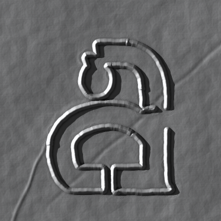
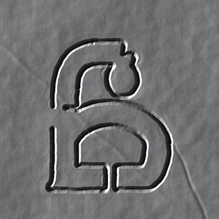
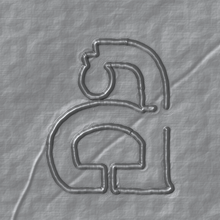
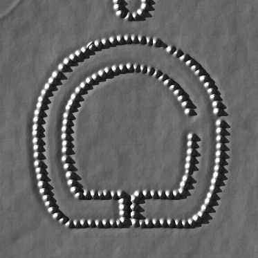
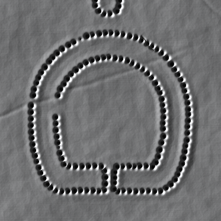
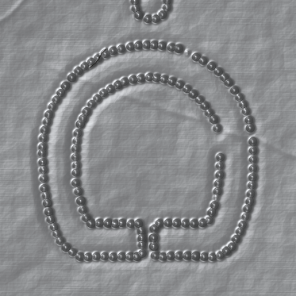

# El repujado, ensayado

Una hoja de papel de aluminio de cocina sobre una base blanda. **La mano dibuja con el puntero y la máquina pone el aluminio.** Se trabaja por el reverso, en espejo; por el anverso sale la letra en relieve, como en la Acción 4 (`../04_taller_analogico.md`).

**Es un ensayo.** La placa de la caja se repuja a mano, en aluminio. Lo que sale de aquí no entra en la caja ni en la fuente (`../06_etica_fuentes_y_pendientes.md`, §6.3), y las imágenes lo dicen en sus datos.

| | Anverso, la luz del registro | Reverso, la luz del registro | Anverso, el taller |
|---|---|---|---|
| **a** (hallada: surco continuo) |  |  |  |
| **ó** (reconstruida: a puntos) |  |  |  |

Las muestras las repujó la mano simulada (`pulso.js`) sobre el calco de la gramática: en tramos, con dudas y con las dos manos, por el reverso. Son muestras de la herramienta, no placas.

## Cómo se abre

- **Sin servidor:** abre `index.html` en el navegador. El calco de los signos usa la gramática de `../aplicacion/`; las letras, `../laminas/fuentes/`.
- **Con servidor,** desde `tipografia/`:

  ```bash
  cd tipografia && python3 -m http.server 8000
  # y abre http://localhost:8000/repujado/
  ```

- **En línea:** el artefacto de Claude [«El repujado de Contenida»](https://claude.ai/artifact/AzCijUBf7Grujskuw7qPmE) (privado; se comparte desde su menú). Es la misma página en un solo archivo: las letras vienen de Google Fonts, y las descargas pasan por el visor, que pide confirmación.

Lo que se dibuja queda guardado en ese navegador. Para llevarlo a otro lado, se descarga el ensayo en JSON.

## Cómo se usa

| | |
|---|---|
| **La cara** · espacio | **El reverso** se ve en espejo: ahí se trabaja. **El anverso** muestra la letra al derecho. La herramienta empuja hacia la cara de abajo: desde el reverso, el relieve sale por el anverso; desde el anverso, se hunde |
| **La herramienta** · 1 a 4 | **Repasar:** el punzón hunde un surco, y los surcos se funden. Lo hallado va con un trazo continuo. **Puntear:** un punto cada 2,25 mm, más o menos, como los pondría una mano; lo reconstruido va a puntos. **Rellenar:** el lado redondo sube la letra de a poco. **Alisar:** la yema baja las arrugas; el surco queda |
| **El punzón y la base** | Un punzón de bola de 1 mm, un bolígrafo sin tinta o un palito de brocheta. La base es fieltro, goma eva, una pila de periódico o una alfombrilla de ratón: cada una hunde y abre distinto, y aguanta distinto |
| **La presión** | Sale de la velocidad (despacio hunde más), del lápiz de una tableta, o es pareja. Además: la fuerza y el temblor de la mano |
| **El calco** · C | Un signo de la caja, la propuesta de la máquina: lo hallado en línea continua, lo reconstruido a puntos y en violeta, y el desagüe. O una imagen: la foto de tu calco. Por el reverso va en espejo |
| **La hoja** | Las arrugas: de la hoja recién salida del rollo a la hoja arrugada y vuelta a alisar. El lado brillante. La hoja doble, para cuando se rompe demasiado. *Cortar otra hoja* rehace lo repujado sobre una hoja nueva |
| **La luz** · L | **El registro:** la foto de la Acción 4, con una sola lámpara rasante, a 15° desde la izquierda; por eso no se mueve. **El taller:** una ventana grande y una tira de luz; el aluminio se ve como metal y la lámpara se mueve libre |
| **El registro** | Lo que diría la ficha: los trazos y por qué cara, los mm de surco y de punteado, el relleno, los contornos sin desagüe, las roturas, el tiempo a mano y con qué mano |
| **Las salidas** | La cara a la vista en PNG, a 1024, 1536 o 2048 px (2048 px son 347 ppp a 1:1). La foto del registro, con las dos caras y la lámpara fija. El ensayo en JSON, que se vuelve a abrir trazo por trazo |

**No hay goma: el aluminio no olvida.** Deshacer es un privilegio de la máquina.

**El desagüe.** Si un contorno vuelve a menos de 2,5 mm de su principio, la mesa avisa: el punzón se detiene 3 mm antes de cerrar (`../03b_anatomia.md`, regla 2). Mientras se dibuja, un círculo violeta marca los 3 mm.

**La rotura.** Si la hoja se rompe, la mesa avisa. La placa rota no se tira: *Guardar la rota y empezar otra* la deja en el registro, como pide la Acción 4.

## De dónde sale: el reel

El método viene de un reel de Instagram, [«Vooolume — Relief Brush Tool»](https://www.instagram.com/reel/DemRiTionHY/), de Krftoools: «nuestra primera herramienta terminada para crear formas semidimensionales». Lo amplían [su video](https://youtu.be/gFGqe2nQBH8) y [su página](https://krftoools.gumroad.com/l/Vooolume-Relief-Brush-Tool). Es una herramienta paga, de un solo archivo, que corre en el navegador. El reel no se sube: se cita (`06`, §6.4).

**Qué muestra el reel** (29,6 s; una grabación de pantalla):

| Segundos | Qué se dibuja |
|---|---|
| 0 a 3 | Los ojos: un óvalo, el iris y la pupila |
| 3 a 6 | Las cejas, y la boca con una rejilla de dientes |
| 6 a 9 | La nariz y las mejillas, garabateadas |
| 9 a 12 | El contorno de la cara, en varias pasadas que se funden en una sola placa |
| 13 a 17 | Las orejas, en espiral, y una corona |
| 18 a 23 | Cambia el material: gemas verdes en la corona y en un ojo, y un diente de oro |
| 23 a 30 | Una cadena de oro con gemas, abajo |

Todo se hace en un solo modo, *raise*, con el material *carved metal* (metal tallado), sobre fondo negro. En la barra de abajo se lee: *pressure: velocity · carved metal* y *55 strokes*.

**Lo que se lee en el panel.**

| Grupo | Controles |
|---|---|
| El pincel | Cuatro materiales: plastilina, metal fundido, metal tallado y plástico reciclado. Cinco tintes por material y uno propio. Un pincel al azar, con la barra espaciadora |
| El modo (Q, W, E, R, T) | *Raise:* «agrega volumen; los trazos se funden en una sola masa». *Stack*, *plate*, *press*, *erase:* «devuelve el material a transparente» |
| El espejo | Apagado, horizontal, vertical o los dos, y copias radiales. «Los ejes quedan quietos mientras dibujás; cada trazo guarda el espejo con que se dibujó» |
| La forma | Tamaño, convexidad, ancho caótico, borde áspero, abolladuras y ruido |
| El lomo (solo el metal tallado) | La escala del verdugón: «0 % es un pliegue puro de cincel; más alto, levanta un verdugón a lo largo del eje» |
| El material | Las costuras del metal fundido. Las astillas del plástico: «son del plástico, no del trazo: esto las vuelve a repartir por toda la hoja» |
| El calco (H) | Cargar una imagen para dibujar encima |
| La luz | Ángulo y elevación: «vuelve a iluminar todo» |
| La superficie | Brillo en los bordes, bisel y el color del fondo: «un JPG se apoya sobre él; un PNG queda transparente» |
| La salida | Hasta 8000 px, con su resolución de impresión; PNG o JPG |

**La ingeniería inversa: lo que tiene que estar haciendo.**

1. **Un mapa de alturas, no un modelo 3D.** Las formas son «semidimensionales»: cada píxel tiene una altura y se ve desde arriba, sin perspectiva.
2. **Cada trazo es una lista de puntos con su presión,** que sale de la velocidad del puntero o del lápiz. Se guarda como vector: así se vuelve a dibujar a 8000 px para la salida, y se deshace.
3. **Cada trazo levanta un perfil alrededor de su eje.** La convexidad da la forma del perfil; el ancho tiembla a lo largo; el borde se rompe con ruido. En el metal tallado, el eje se hunde en un pliegue de cincel o sube en un verdugón.
4. **El modo es cómo se junta el perfil nuevo con lo que ya está:** el máximo (se funden), la suma (se apilan), la resta (se aprietan) o cero (se borran).
5. **La textura es del material, no del trazo.** Está en la hoja, antes de dibujar, y cada trazo la descubre.
6. **La luz se calcula al final, desde las normales del mapa.** Por eso moverla vuelve a iluminar todo: un metal que refleja un entorno, más una lámpara.
7. **Cada trazo guarda su espejo.**

**Qué sirve para el repujado y qué no.**

| | De Vooolume | En el ensayo |
|---|---|---|
| **Se toma** | El mapa de alturas. Los trazos que se funden por el máximo. El trazo como vector con su presión, que sale de la velocidad. La textura del material, no del trazo. La luz al final, que se mueve. El calco debajo. La salida a cualquier tamaño, redibujada desde los trazos | Todo eso está en `repujado.js` |
| **Cambia** | El perfil convexo, de plastilina | La bola contra una base blanda: una cresta entre dos cunetas (lo toma de la primera simulación, abajo) |
| | Los cinco modos | Cuatro herramientas de la Acción 4: repasar, puntear, rellenar y alisar. Hacia dónde empuja no es un modo: es la cara que se trabaja |
| | El ruido y las abolladuras | Las arrugas de la hoja, sus dobleces, el veteado del laminado y el filo de la tijera |
| | Una luz | Dos: el taller (un entorno y una lámpara) y el registro (la foto de la Acción 4) |
| **Se deja** | Los cuatro materiales y sus tintes | Solo aluminio: el color es material (`03`, §3.9) |
| | El espejo y las copias radiales | Las letras no son simétricas: el único espejo es el del reverso |
| | El pincel al azar y el brillo de los bordes | — |
| **No se hace** | Borrar | El aluminio no olvida. Deshacer es un privilegio de la máquina |
| | Las gemas, el oro y la cara con corona del reel | Ningún motivo pasa a las letras (`06`, §6.4) |
| **Se suma** | — | El reverso y el anverso, en espejo. El desagüe. La rotura. El registro de la ficha. La procedencia en los datos de la imagen. El ensayo en JSON, para rehacerlo |

## Y de la primera simulación

La placa ya estaba simulada en `../simulacion/contener.py` (la propuesta de la máquina), y la aplicación de septiembre la llevaba al navegador. La primera versión de este ensayo era peor en la imagen, aunque mejor en la mecánica. Se volvió a la primera en tres cosas:

| | La primera (`contener.py`) | La primera versión del ensayo | Ahora |
|---|---|---|---|
| **La línea** | Una cresta angosta entre dos cunetas: con luz rasante se lee nítida, hundida en el aluminio | Un tubo redondo y ancho: parecía un alambre pegado | La cresta y las cunetas de la primera, medidas en mm y en anchos del surco |
| **La hoja** | Tranquila: ondas suaves, dos dobleces rectos, el veteado y el filo levantado | Arrugas facetadas que competían con la letra | La de la primera. Las arrugas facetadas quedan como opción |
| **La luz** | La foto del registro: difusa más especular, en gris, a 15° desde la izquierda | Solo el reflejo del metal | El registro es la luz de la primera, ahora con sombras. El taller es la de Vooolume |

**Lo que el ensayo agrega a la primera:**

- dibuja la mano, no la máquina;
- todo se mide en milímetros, con el punzón y la base;
- tiene el reverso y el anverso en espejo, y el desagüe;
- la rotura depende del esfuerzo acumulado;
- la luz proyecta sombras y se puede mover;
- la salida va a cualquier tamaño y con su procedencia.

## El modelo

- **La placa** mide 150 mm, un azulejo. La altura se mide en mm y es positiva hacia el anverso.
- **El surco.** Su profundidad es *D* = hondo de la base × presión × fuerza, hasta el límite de la base. Su medio ancho es *w* = radio de la bola + 0,35 √(2 · radio · *D*) + 0,25 · abre · *D*.
  - El perfil es el de `contener.py`: 2,6 · cresta − 1,1 · (ancho − cresta), en anchos del surco. Las cunetas bajan más en una base firme.
  - Los tramos de un trazo se funden por el máximo. Las cunetas de los puntos se suman.
  - Cada surco se mide desde lo que ya estaba: una línea sobre una zona rellena se hunde desde la zona.
  - El temblor mueve la presión y el ancho a lo largo del recorrido, apenas. A los lados, el aluminio se frunce.
  - El surco se estampa cada 0,5 mm a lo largo del recorrido, lleguen los puntos tan juntos como lleguen.
  - Donde el punzón arranca y donde se detiene, descansa y hunde un poco más.
- **La rotura.** El esfuerzo, (*D* / *w*)² por mm de recorrido, se acumula en una grilla de 0,5 mm. Cada celda aguanta hasta un umbral con semilla, de Weibull de módulo 6: la hoja es pareja y se rompe por trabajarla de más. Un punto vale 1,6 (*D* / *w*)²: el punteado rompe más. La hoja doble aguanta 2,5 veces más.
- **El pulso.** En la mesa, la mano es la tuya: la máquina no le agrega temblor. Agrega solo lo que la pantalla no tiene del aluminio, y es sutil:
  - si la mano se queda quieta apretando (un tercio de segundo), el punzón descansa ahí y hunde un poco más;
  - el punteado no cae a paso de máquina: cada punto, un poco antes o un poco después (un 7 %), un poco al costado (0,06 mm) y apretando distinto (un 5 %).
- **La mano simulada** (`pulso.js`, la misma de `../simulacion/pulso.py`) repuja las muestras: levanta el punzón (un contorno se hace en tramos que, al retomar, se montan sobre lo hecho), va más despacio en las curvas, sigue la línea con retardo, se desvía y se corrige, tiembla un poco, duda, aprieta distinto, tiene direcciones cómodas, lee el anverso con la otra mano y se cansa con los minutos de la sesión. Son supuestos de la motricidad, no medidas de una mano.
- **El azar** tiene semilla: el día de la obra, como en la simulación. La misma hoja y los mismos trazos dan siempre la misma placa.
- **La luz.**
  - *El registro:* 0,16 + 0,95 · difusa + especular (^18 en la cara brillante, ^8 en la mate), con sombras barridas desde la lámpara.
  - *El taller:* el aluminio como metal, con Fresnel de 0,91, una ventana a 35° del lado de la lámpara, una tira del otro lado y la lámpara.
  - Las dos llevan la oclusión de los surcos.

**Lo que falta medir.** Son supuestos de la máquina. Se miden repujando una placa de prueba en cada base, y se corrigen en `BASES` (`repujado.js`):

| Base | Hondo (mm, con presión 1) | Cuánto abre | Cunetas | Se rompe pasando |
|---|---|---|---|---|
| Fieltro | 1,0 | 0,85 | 0,13 | 1,6 mm |
| Goma eva | 0,75 | 0,65 | 0,17 | 1,2 mm |
| Una pila de periódico | 0,52 | 0,5 | 0,22 | 0,9 mm |
| Una alfombrilla de ratón | 0,8 | 0,7 | 0,15 | 1,3 mm |

También son supuestos la tenacidad del aluminio (4,4, en `TENACIDAD`) y el tiempo, que sale de la mano simulada, como en la simulación (`MANO`): 230 mm de surco y 136 mm de punteado por minuto, con sus levantadas, dudas y lecturas; 4 minutos para cortar la hoja y pegar el calco, y 1 para retirarlo.

## Archivos

| Archivo | Qué es |
|---|---|
| `index.html` | La mesa: la placa y las herramientas |
| `mesa.js` | La mano: el puntero, la presión, el calco, la luz, el registro y las salidas |
| `repujado.js` | El motor: la hoja, el punzón, la base, el surco, la rotura y la luz. No depende de nada; corre en el navegador y en Node |
| `pulso.js` | La mano simulada, la de `../simulacion/pulso.py`: repuja las muestras. La mesa no la usa: ahí la mano es la tuya |
| `prueba.mjs` | Las pruebas del motor. Con `--imagenes muestras` rehace las muestras de arriba |
| `muestras/` | La a y la ó de las muestras, por las dos caras |

```bash
node tipografia/repujado/prueba.mjs                       # las pruebas, unos 10 segundos
node tipografia/repujado/prueba.mjs --imagenes tipografia/repujado/muestras
```

Las pruebas comprueban:

- que la hoja sale siempre igual;
- que el punzón por el reverso levanta el anverso;
- que rehacer da lo mismo que dibujar, y que deshacer vuelve atrás;
- que el reverso es el anverso dado vuelta;
- que el contorno cerrado se marca;
- que el punteado rompe más que el surco;
- que la mano quieta, apretando, hunde un poco más, y que rehacer lo repite;
- que la mano simulada sale siempre igual, levanta y se cansa, y que se aparta poco de la línea;
- y cuánto tarda la luz.

Hecho con asistencia de IA. La máquina vio el reel cuadro por cuadro, leyó su panel y escribió el motor sin ver el código de Vooolume. Lo que se sabe de Vooolume sale de lo que muestran el reel, el video y su página.
